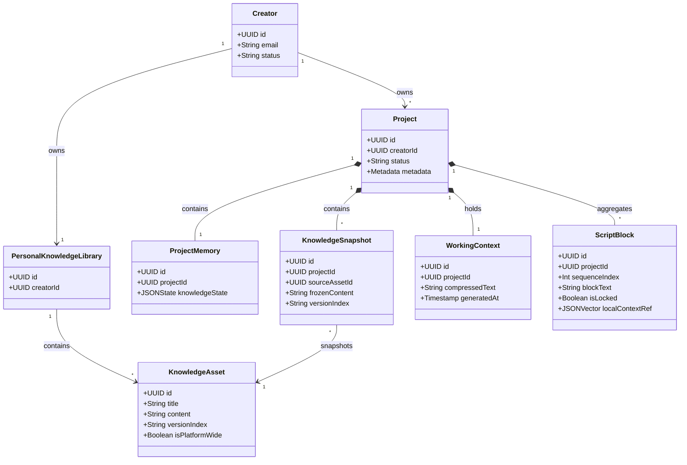

# STATUS: ACTIVE WORKING SPECIFICATION (v0.1.0)

# Domain Model Specification

| Metadata Field | Value |
| :--- | :--- |
| **Document Name** | Domain Model Specification |
| **Version** | 0.1.0 |
| **Status** | Active Working Spec |
| **Last Updated** | 2026-07-16 |
| **Owner** | Rishi AI Founder & CTO |
| **Change Summary** | Initial logical modeling baseline formalizing logical domains, aggregates, state transitions, and rules. |

---

## Traceability & Alignment
* **Parent Document:** [Product Requirements Document (PRD)](file:///c:/Users/Anmol/Desktop/rishi-ai/.docs/PRODUCT_REQUIREMENTS_DOCUMENT.md) (Derives business rules and validation scope)
* **Downstream Target:** [System Design Document (SDD)](file:///c:/Users/Anmol/Desktop/rishi-ai/.docs/SYSTEM_DESIGN_DOCUMENT.md) (Determines physical schema mapping and ORM boundaries)

---

## 1. Domain Architectural Boundaries

The Rishi AI domain is modeled as a set of logical boundaries designed to maintain a clean separation of concerns and ensure tenant isolation. The primary aggregate root is the **Project**, which encapsulates all content production workflows.



---

## 2. Entity Specifications & Invariants

### 2.1 Creator (Tenant Root)
* **Responsibilities:**
  * Serves as the primary actor, security boundary, and billing owner.
  * Encapsulates credentials, configuration preferences, and access logs.
* **Ownership Boundary:**
  * Boundaries are strictly isolated. A Creator owns their Personal Knowledge Library and Projects. 
  * Cross-tenant access is prohibited.
* **Invariants:**
  * Must have a globally unique identifier (UUID).
  * Must be associated with a valid, verified email address.
* **Lifecycle States:**
  * `Active`: Account verified; access permitted.
  * `Suspended`: Access blocked due to billing or abuse.
  * `Deleted`: Marked for deletion; data purge queue initialized.
* **Allowed State Transitions:**
  ```mermaid
  stateDiagram-v2
      [*] --> Active : Registration (OTP/OAuth)
      Active --> Suspended : Billing Failure / Abuse
      Suspended --> Active : Resolved Issue
      Active --> Deleted : User Request
      Suspended --> Deleted : Founder Cleanup
  ```

### 2.2 Knowledge Asset
* **Responsibilities:**
  * Represents structural content, scriptural translations, stylistic rules, or reference texts.
  * Can exist inside a Creator’s `Personal Knowledge Library` or as part of the pre-seeded read-only `Platform Knowledge Library`.
* **Invariants:**
  * Must possess a version index which increments upon modifications.
  * Must belong either to a specific Creator or to the Platform.
* **Lifecycle States:**
  * `Active`: Referenceable by projects.
  * `Deprecated`: Retained for historical references but hidden from new project links.
  * `Deleted`: Removed from libraries; existing project snapshots remain unaffected.
* **Allowed State Transitions:**
  ```mermaid
  stateDiagram-v2
      [*] --> Active : Created
      Active --> Deprecated : Updated/Archived
      Active --> Deleted : User Deletes
      Deprecated --> Deleted : User Purges
  ```

### 2.3 Project (Aggregate Root)
* **Responsibilities:**
  * Acts as the primary container for the content production pipeline.
  * Governs the orchestration of child entities: `Project Memory`, `Knowledge Snapshot`, `Working Context`, and `Script Blocks`.
* **Invariants:**
  * Must possess a single Creator owner.
  * Must maintain a current sequential state matching the 9-stage production pipeline.
  * Downstream entities (Script Blocks) cannot exist without a parent Project.
* **Ownership Boundary:**
  * All mutations to Script Blocks, Working Context, and Snapshots must go through the Project aggregate root interface.
* **State Lifecycle & Allowed Transitions:**
  * States correspond directly to the content production phases:
    1. `Draft`: Project shell created.
    2. `Research`: Hierarchical knowledge extraction execution.
    3. `Knowledge Organized`: Source curation and summarization.
    4. `Working Context Generated`: Vector synthesis and context compression.
    5. `Outline Generated`: Chapters and outline structure mapped.
    6. `Script Generated`: Script blocks populated.
    7. `Review`: Final editorial and review.
    8. `Exported`: Project export completed.
    9. `Archived`: Project frozen as read-only.
  * **Transition Rules:**
    * Progression is guided sequentially (`Draft -> Research -> Knowledge Organized -> Working Context Generated -> Outline Generated -> Script Generated -> Review -> Exported -> Archived`).
    * Creators can explicitly step backward to previous stages to edit parameters (e.g., reverting to `Knowledge Organized` to change sources). If this occurs, downstream stages (like `Script Generated`) display warning flags, but user data (specifically `Locked` blocks) remains preserved.
    * A Creator can transition a Project to `Archived` from any active stage.
    * Unarchiving restores the Project to its prior active state.
  ```mermaid
  stateDiagram-v2
      [*] --> Draft : Create Project
      Draft --> Research : Capture Idea
      Research --> KnowledgeOrganized : Organize Sources
      KnowledgeOrganized --> WorkingContextGenerated : Generate Context
      WorkingContextGenerated --> OutlineGenerated : Generate Outline
      OutlineGenerated --> ScriptGenerated : Generate Script
      ScriptGenerated --> Review : Finalize Editor
      Review --> Exported : Export Script
      Exported --> Archived : Archive Project
      Draft --> Archived : Cancel
      Research --> Archived : Cancel
      KnowledgeOrganized --> Archived : Cancel
      WorkingContextGenerated --> Archived : Cancel
      OutlineGenerated --> Archived : Cancel
      ScriptGenerated --> Archived : Cancel
      Review --> Archived : Cancel
      Exported --> Archived : Cancel
      Archived --> Draft : Restore
  ```

### 2.4 Knowledge Snapshot (Snapshot Reference Model)
* **Responsibilities:**
  * Captures the exact textual payload and metadata state of a `Knowledge Asset` at the instant it is linked to a Project.
  * Guarantees absolute repeatability of LLM generation runs by insulating the project pipeline from future changes to source documents.
* **Invariants:**
  * **Immutable:** A snapshot can never be modified or updated once written.
  * Must refer to a valid originating source `Knowledge Asset` and its specific version index.
* **Lifecycle States:**
  * `Active`: Locked context representing source information for the project.
  * `Orphaned`: Originating asset deleted from library; snapshot persists for project integrity.
* **Allowed State Transitions:**
  * Snapshots are write-once, read-many assets. There are no state transitions.

### 2.5 Project Memory
* **Responsibilities:**
  * Maintains the cumulative, evolving state of project knowledge.
  * Tracks user decisions, approved AI text blocks, uploaded assets, and workflow notes.
* **Invariants:**
  * Must have a strict 1-to-1 relationship with its parent Project.
* **Lifecycle States:**
  * `Active`: Write-enabled, continuously updating based on pipeline stages.
  * `Locked`: Read-only, triggered when the parent Project enters the `Archived` state.
* **Allowed State Transitions:**
  ```mermaid
  stateDiagram-v2
      [*] --> Active : Project Initialized
      Active --> Locked : Project Archived
      Locked --> Active : Project Restored
  ```

### 2.6 Working Context
* **Responsibilities:**
  * Represents the transient, highly optimized text representation of the project's knowledge footprint.
  * Synthesized sequentially from the `Project Memory` and `Knowledge Snapshots` based on active workflow requirements.
* **Invariants:**
  * Must be generated deterministically.
* **Lifecycle States:**
  * `Empty`: Uninitialized.
  * `Valid`: Actively matching the project's memory.
  * `Stale`: The parent Project's memory or linked Snapshots have modified since the context was last compiled, triggering a Context Drift warning.
* **Allowed State Transitions:**
  ```mermaid
  stateDiagram-v2
      [*] --> Empty
      Empty --> Valid : Compile Context
      Valid --> Stale : Source Asset/Memory Update
      Stale --> Valid : Recompile Context
  ```

### 2.7 Script Block
* **Responsibilities:**
  * Represents a self-contained, ordered section of the final Editorial Script document.
  * Holds references to its own targeted context slice, enabling independent regeneration.
* **Invariants:**
  * Must maintain a sequence index indicating its relative position in the script.
  * If `isLocked` is true, AI orchestration commands are barred from editing, overwriting, or regenerations.
* **Lifecycle States:**
  * `Draft`: Empty structural chapter.
  * `Generated`: Populated by AI matching outline guidelines.
  * `Locked`: Manually edited by the Creator or marked as protected from AI overwrite.
  * `Unlocked`: AI updates permitted again.
* **Allowed State Transitions:**
  ```mermaid
  stateDiagram-v2
      [*] --> Draft : Chapter Created
      Draft --> Generated : AI Run
      Draft --> Locked : User Types Manually
      Generated --> Locked : User Edits / Manual Toggle
      Locked --> Unlocked : Manual Toggle
      Unlocked --> Generated : AI Regenerate
  ```

---

## 3. Edge-Case Resolution Placeholders

To maintain structural clarity, the following logical edge cases are identified for future resolution in collaboration with the founder:
1. **Dangling Snapshots:** Strategy for purging snapshots when a project is permanently deleted (ensuring database space optimization vs. archiving requirements).
2. **Context Blowout Handling:** Policy for when the aggregated Working Context exceeds downstream LLM context parameters.
3. **Lock Overrides:** Policy for what happens when a user requests a global script rewrite while individual blocks are locked (prompt warnings vs. strict bypass).
