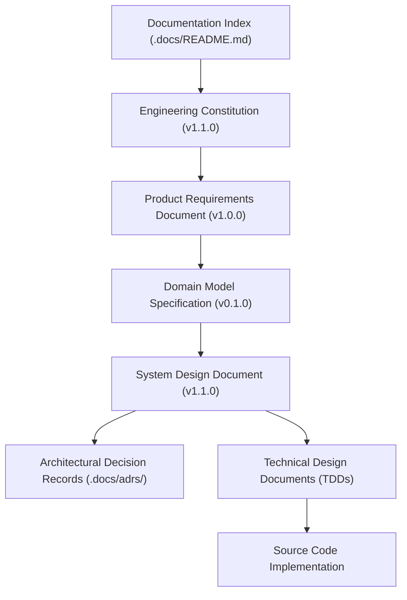

# Rishi AI Documentation Repository

Welcome to the central documentation repository for **Rishi AI** (AI-powered Content Production Operating System). This directory serves as the single source of truth for the product's requirements, architectural principles, domain definitions, system designs, and technical design documents.

---

## 1. Documentation Philosophy

We treat documentation as a core part of the product, not as a secondary chore. High-quality documentation reduces developer onboarding friction, prevents context loss, helps manage founder budget constraints by ensuring design clarity before coding, and guides AI development.

Our core documentation principles are:
* **Documentation Boundary:** Clear separation of concerns. Business requirements (What and Why) live in the Product Requirements Document (PRD). Technical specifications (How) are deferred to the System Design Document (SDD) and Technical Design Documents (TDDs).
* **Traceability:** Every technical solution in the code or SDD must map directly to a business requirement defined in the PRD, which in turn maps to an engineering guideline in the Constitution.
* **Immutability of Baselines:** Frozen documents represent alignment between the founder and the engineering team. They can only be modified through explicit review.

---

## 2. Document Hierarchy & Reading Order

For a new contributor or auditor, the documentation must be read in the following logical order:

1. **[README.md](file:///c:/Users/Anmol/Desktop/rishi-ai/.docs/README.md) (This File):** Explains how to navigate the documentation.
2. **[Engineering Constitution](file:///c:/Users/Anmol/Desktop/rishi-ai/.docs/ENGINEERING_CONSTITUTION.md):** Defines high-level business goals, founder financial constraints, technical philosophy, and success criteria.
3. **[Product Requirements Document](file:///c:/Users/Anmol/Desktop/rishi-ai/.docs/PRODUCT_REQUIREMENTS_DOCUMENT.md):** Details the target persona, user problems, 9-stage content pipeline, script block schema, and functional rules.
4. **[Domain Model Specification](file:///c:/Users/Anmol/Desktop/rishi-ai/.docs/DOMAIN_MODEL_SPECIFICATION.md):** Translates requirements into technology-agnostic logical models (Creator, Project, Snapshot, etc.).
5. **[System Design Document](file:///c:/Users/Anmol/Desktop/rishi-ai/.docs/SYSTEM_DESIGN_DOCUMENT.md):** Lays out the physical topology, database selection, auth strategies, background workers, and cross-cutting concerns.
6. **[Architectural Decision Records (ADRs)](file:///c:/Users/Anmol/Desktop/rishi-ai/.docs/adrs/README.md):** Records the context, options, and rationale for load-bearing architectural choices.

---

## 3. Document Ownership & Lifecycle

We classify documents into three lifecycle states:

| Document Type | Status | Lifecycle State | Owner | Mutability |
| :--- | :--- | :--- | :--- | :--- |
| **Engineering Constitution** | Frozen | Baseline | Founder & CTO | Immutable (requires formal founder review to change) |
| **Product Requirements Document** | Frozen | Baseline | Founder | Immutable (requires formal founder review to change) |
| **Domain Model Specification** | Active | Working Spec | CTO & Tech Leads | Mutable (evolves with design phases) |
| **System Design Document** | Frozen | Baseline | CTO | Immutable (requires formal founder review to change) |
| **Architectural Decision Records** | Logged | Historic Log | CTO & Engineers | Append-Only (never modified after commit; superseded via new records) |

---

## 4. Versioning Policy

Documents follow semantic versioning conventions adapted for specifications:
* **v1.x.x (Major.Minor.Patch) - Frozen Baseline:** Formally agreed and frozen. Patch increments represent typographical or formatting fixes. Minor increments represent backward-compatible scope changes. Major increments represent complete revisions.
* **v0.x.x - Active Working Specification:** Open for modification during active design phases. Changes must be documented in a changelog table at the head of the file.

---

## 5. Cross-Reference Strategy

To maintain traceability, documents must cross-reference each other using absolute markdown links pointing to workspace directories:
* Links must point directly to files using the `file:///c:/Users/Anmol/Desktop/rishi-ai/.docs/` scheme.
* Use anchor tags (`#section-id`) to link directly to specific sections or entities (e.g., pointing from the SDD to a specific invariant in the Domain Model Specification).
* Avoid plain-text references to files without links.
