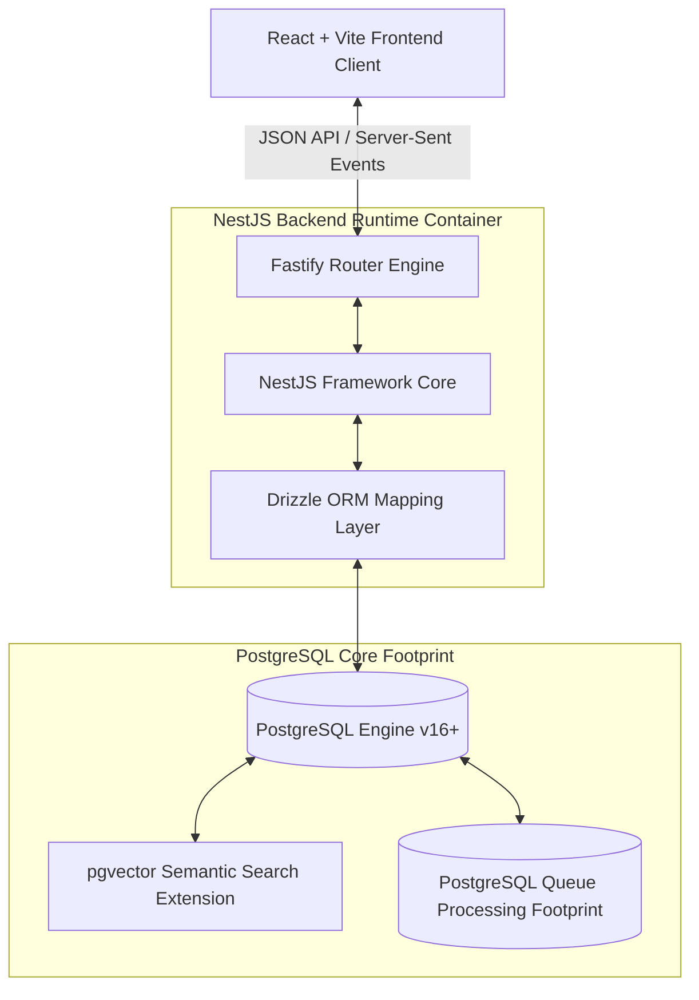
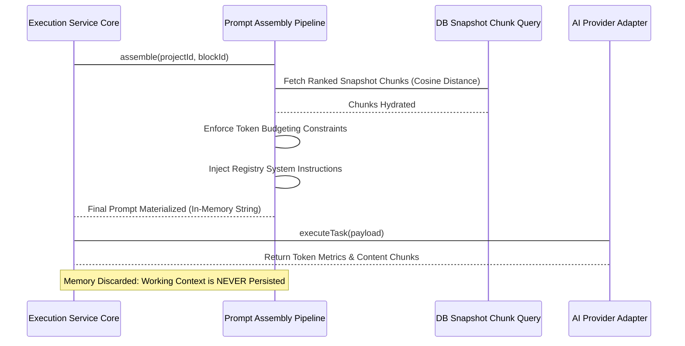

# Rishi AI — System Design Document (SDD)

| Metadata Field | Value |
| :--- | :--- |
| **Document Name** | System Design Document (SDD) |
| **Version** | 1.1.0 |
| **Status** | Frozen |
| **Last Updated** | 2026-07-16 |
| **Owner** | Rishi AI Founder & CTO |
| **Lifecycle** | Reference |
| **Current Authority** | Level 4 — Intended system architecture where approved and non-superseded |
| **Implementation Status** | Partially Implemented |
| **Last Verified** | 2026-07-31 |
| **Change Summary** | Initial structural framework and skeleton directory mapping future design spaces. |

## Version 1.1.0 — Frozen Baseline

This document specifies the concrete physical architecture, technology stacks, database schemas, network protocols, operational abstractions, and execution lifecycles for Rishi AI Version 1.0.0. In strict accordance with the Engineering Constitution, this document serves as the absolute implementation blueprint for the engineering phase, bridging logical domain requirements with a structural, type-safe software architecture.

---

## 1. Core Tech Stack & Codebase Topology

### 1.1 The Zero-Budget Technology Stack

To ensure maximum solo developer execution speed, type safety across all network barriers, and absolute alignment with our zero-dollar operational infrastructure mandates, the core physical architecture is locked to the following layers:



* **Frontend System:** **React managed via Vite**. Employs lightweight, client-side rendering focused entirely on document editing interactions, avoiding heavy node-hosting operational bills.
* **Backend System Core:** **NestJS configured natively with the Fastify Adapter**.
> [!WARNING]
> **Express must not be used under any circumstances.** Fastify is explicitly required to maintain sub-millisecond route parsing, an exceptionally small idle memory footprint, and high request encapsulation.


* **Programming Language:** **TypeScript (End-to-End)**. Shared interface definitions guarantee full type validation spanning from raw SQL rows up to user view representations.
* **Database Infrastructure Engine:** **PostgreSQL (v16+)** managed structurally via **Drizzle ORM**. Drizzle is locked in to eliminate cold-start lag, reduce object-relational abstraction runtime overhead, and provide declarative, schema-driven script interfaces.
* **Vector Query Architecture:** **`pgvector` Extension**. All localized semantic block indexing, vector generation mappings, and search execution occur natively within the primary database cluster, eliminating multi-tenant SaaS indexes. Embedding dimensions are configuration-driven to ensure long-term model adaptability.
* **Asynchronous Processing:** Abstracted via a centralized application service wrapper (`QueueService`) executing directly over the core PostgreSQL transactional storage engine via localized runner daemons (`graphile-worker` default core).
* **Testing Infrastructure Engine:** **Vitest**. Locked in for near-instant mock compilation and clean native execution within the logical monolith boundaries.

### 1.2 Codebase Directory Topology (The Logical Monolith)

To secure developer speed while providing zero-refactor microservice readiness, the codebase is arranged as a modular monolith within a single repository framework:

```text
rishi-ai/
├── .docs/                 # Frozen architectural & product specs
│   ├── ENGINEERING_CONSTITUTION.md
│   ├── PRODUCT_REQUIREMENTS_DOCUMENT.md
│   ├── DOMAIN_MODEL_SPECIFICATION.md
│   └── SYSTEM_DESIGN_DOCUMENT.md
├── src/
│   ├── client/            # Document-First React client workspace
│   └── server/
│       ├── app.module.ts  # NestJS application container framework root
│       ├── main.ts        # Fastify instantiation bootstrapper
│       ├── shared/        # Shared core database configurations, logging utilities
│       └── modules/       # Rigid logical domain encapsulation structures
│           ├── auth/      # Identity tracking & social callback flows
│           ├── projects/  # Project State machine lifecycle management
│           ├── knowledge/ # Multi-layer parsing, chunk storage, vector search
│           ├── prompt/    # Centralized versioned prompt configuration registries
│           └── execution/ # Generation Jobs orchestration logic
├── tsconfig.json
└── package.json

```

---

## 2. Physical Database Schema & Relational Mapping

### 2.1 Database Enums

```sql
CREATE TYPE project_state AS ENUM (
  'draft', 'research', 'knowledge_organized', 'working_context_generated', 
  'outline_generated', 'script_generated', 'review', 'exported', 'archived'
);

CREATE TYPE job_status AS ENUM (
  'pending', 'processing', 'success', 'failed', 'cancelled'
);

```

### 2.2 Relational Schema & Structural Layouts (Drizzle Schema)

To enforce the Snapshot Preservation Policy, physical document data structures physically partition global reference text logs from unalterable context execution copies:

```typescript
import { pgTable, uuid, text, integer, boolean, timestamp, jsonb, customType } from 'drizzle-orm/pg-core';

// Configuration-driven vector layout supporting dynamic external models
const pgVector = customType<{ data: number[] }>({
  dataType() { return 'vector'; } 
});

export const creators = pgTable('creators', {
  id: uuid('id').primaryKey().defaultRandom(),
  email: text('email').notNull().unique(),
  createdAt: timestamp('created_at').defaultNow().notNull(),
});

export const knowledgeAssets = pgTable('knowledge_assets', {
  id: uuid('id').primaryKey().defaultRandom(),
  creatorId: uuid('creator_id').references(() => creators.id, { onDelete: 'cascade' }).notNull(),
  title: text('title').notNull(),
  storagePath: text('storage_path').notNull(),
  versionId: integer('version_id').notNull().default(1),
  deletedAt: timestamp('deleted_at'), // Soft delete anchor restricted to mutable layer
});

export const knowledgeChunks = pgTable('knowledge_chunks', {
  id: uuid('id').primaryKey().defaultRandom(),
  assetId: uuid('asset_id').references(() => knowledgeAssets.id, { onDelete: 'cascade' }).notNull(),
  chunkText: text('chunk_text').notNull(),
  embedding: pgVector('embedding').notNull(),
  chunkIndex: integer('chunk_index').notNull(),
  tokenCount: integer('token_count').notNull(),
  embeddingProvider: text('embedding_provider').notNull(),
  embeddingModel: text('embedding_model').notNull(),
  embeddingDimension: integer('embedding_dimension').notNull(),
  embeddingVersion: text('embedding_version').notNull(),
  generatedAt: timestamp('generated_at').defaultNow().notNull(),
});

export const projects = pgTable('projects', {
  id: uuid('id').primaryKey().defaultRandom(),
  creatorId: uuid('creator_id').references(() => creators.id, { onDelete: 'cascade' }).notNull(),
  title: text('title').notNull(),
  state: text('state').$type<text>().default('draft').notNull(),
  version: integer('version').default(1).notNull(), // Optimistic locking version
  createdAt: timestamp('created_at').defaultNow().notNull(),
  updatedAt: timestamp('updated_at').defaultNow().notNull(),
  deletedAt: timestamp('deleted_at'),
});

export const knowledgeSnapshots = pgTable('knowledge_snapshots', {
  id: uuid('id').primaryKey().defaultRandom(),
  projectId: uuid('project_id').references(() => projects.id, { onDelete: 'cascade' }).notNull(),
  assetId: uuid('asset_id').references(() => knowledgeAssets.id, { onDelete: 'set null' }),
  capturedVersionId: integer('captured_version_id').notNull(),
  attachedAt: timestamp('attached_at').defaultNow().notNull(),
});

export const snapshotChunks = pgTable('snapshot_chunks', {
  id: uuid('id').primaryKey().defaultRandom(),
  snapshotId: uuid('snapshot_id').references(() => knowledgeSnapshots.id, { onDelete: 'cascade' }).notNull(),
  chunkText: text('chunk_text').notNull(),
  embedding: pgVector('embedding').notNull(),
  chunkIndex: integer('chunk_index').notNull(),
  tokenCount: integer('token_count').notNull(),
  embeddingProvider: text('embedding_provider').notNull(),
  embeddingModel: text('embedding_model').notNull(),
  embeddingDimension: integer('embedding_dimension').notNull(),
});

export const scriptBlocks = pgTable('script_blocks', {
  id: uuid('id').primaryKey().defaultRandom(),
  projectId: uuid('project_id').references(() => projects.id, { onDelete: 'cascade' }).notNull(),
  sortOrder: integer('sort_order').notNull(),
  isLocked: boolean('is_locked').default(false).notNull(),
  title: text('title').notNull(),
  content: text('content').default('').notNull(),
});

export const scriptBlockSources = pgTable('script_block_sources', {
  id: uuid('id').primaryKey().defaultRandom(),
  blockId: uuid('block_id').references(() => scriptBlocks.id, { onDelete: 'cascade' }).notNull(),
  snapshotChunkId: uuid('snapshot_chunk_id').references(() => snapshotChunks.id, { onDelete: 'restrict' }).notNull(),
  relevanceScore: integer('relevance_score').notNull(), // Multiplied by 100 in database
  citationOrder: integer('citation_order').notNull(),
});

export const projectMemories = pgTable('project_memories', {
  id: uuid('id').primaryKey().defaultRandom(),
  projectId: uuid('project_id').references(() => projects.id, { onDelete: 'cascade' }).notNull(),
  eventType: text('event_type').notNull(),
  payload: jsonb('payload').default('{}').notNull(),
  createdAt: timestamp('created_at').defaultNow().notNull(),
});

export const generationJobs = pgTable('generation_jobs', {
  id: uuid('id').primaryKey().defaultRandom(),
  projectId: uuid('project_id').references(() => projects.id, { onDelete: 'cascade' }).notNull(),
  correlationId: uuid('correlation_id').notNull(),
  status: text('status').$type<text>().default('pending').notNull(),
  executionType: text('execution_type').notNull(),
  provider: text('provider').notNull(),
  modelName: text('model_name').notNull(),
  promptTemplateVersion: text('prompt_template_version').notNull(),
  contextVersion: text('context_version').notNull(),
  retryCount: integer('retry_count').default(0).notNull(),
  errorLog: text('error_log'),
  startedAt: timestamp('started_at').notNull(),
  completedAt: timestamp('completed_at'),
  executionDurationMs: integer('execution_duration_ms'),
  promptTokens: integer('prompt_tokens'),
  completionTokens: integer('completion_tokens'),
  estimatedCostUsd: text('estimated_cost_usd'),
});

```

### 2.3 Physical Index Structural Enforcements

To optimize data retrieval under single-instance resource constraints, the storage layer applies the following system indexes:

* **Tenant Separation Optimization Index:** Composite B-Tree index on `(creator_id, id)` across `projects` and `knowledge_assets`.
* **Semantic Invariant Index:** An **HNSW (Hierarchical Navigable Small World)** performance index generated over the `embedding` row layout of `snapshot_chunks`, configured specifically utilizing cosine metric distance parameters (`vector_cosine_ops`).
* **Block Ordering Index:** Standard relational query B-Tree structure bound to `(project_id, sort_order)` on table layout `script_blocks`.

### 2.4 Soft Delete Policy

The data access layer enforces soft delete constraints strictly through repository implementations:

* **Mutable Creator Entities (`knowledge_assets`, `projects`):** When the `softDelete(id)` command fires, the database repository updates the `deleted_at` timestamp column to `now()`. Base query selectors automatically append an SQL conditional filter (`WHERE deleted_at IS NULL`).
* **Immutable Records (`knowledge_snapshots`, `snapshot_chunks`, `project_memories`, `generation_jobs`):** These tables completely lack a `deleted_at` column. If a repository delete command is mistakenly directed at these domains, the implementation method explicitly throws a compile-time exception, completely blocking row destruction.

---

## 3. AI Provider Abstraction Layer & Ephemeral Prompt Pipeline

### 3.1 Structural Provider Independence Interfaces

All model processing operations pass exclusively through an abstract runtime token structure managed via NestJS Dependency Injection:

```typescript
export interface PromptPayload {
  systemInstructions: string;
  userPrompt: string;
  temperature: number;
  maxTokens?: number;
}

export interface ProviderResponse {
  rawOutput: string;
  promptTokens: number;
  completionTokens: number;
  modelName: string;
  providerName: string;
}

export interface IAiProviderAdapter {
  executeTask(payload: PromptPayload): Promise<ProviderResponse>;
}

```

### 3.2 The Ephemeral Prompt Pipeline

Prompt assembly handles data parsing tasks strictly in volatile application memory context layout, adhering to the **Working Context Principle**.



1. **Context Aggregation:** The pipeline queries the `SnapshotChunkRepository` and `ProjectMemoryRepository` using domain event data. It identifies user-pinned text segments, recent text blocks, and relevant reference fragments.
2. **Token Budget Enforcer:** The pipeline counts tokens dynamically. If the payload size threatens context window margins or budget parameters, it compresses context by dropping lower-ranked chunks or summarizing historical notes.
3. **Instruction Injection:** The system appends specific system directives, layout formats, and target tones linked to the active project state from a centralized `PromptTemplateRegistry`.
4. **Ephemeral Materialization:** The final prompt string is passed directly to the adapter. The compiled `Working Context` object is **never saved to the database**; it exists purely in memory and is discarded immediately after passing to the provider.

### 3.3 Post-AI Response Validation Layer

Before string content returned from external model systems updates our primary table schemas, data targets clear a verification runner pipeline:

1. **Structural Extraction:** Runs JSON parsing schemas or markdown block syntax tests.
2. **Completeness Invariant Verification:** Confirms all core structural elements mapped to the target pipeline phase match completely.
3. **Citation Integrity Check:** Asserts that reference markers inside the layout correctly link to an authentic, un-purged `snapshot_chunk_id` record.
4. If constraints fail, execution drops, throwing a validation exception while logging trace events to the `generation_jobs` record without altering script block states.

---

## 4. Asynchronous Processing & Database-Backed Background Workers

### 4.1 Decorator-Based Background Orchestration

Async operations bypass shared API threads completely. Processing boundaries standardize around a programmatic injection syntax handled by a localized service wrapper:

```typescript
// Core system task processor integration blueprint
@Injectable()
@ProcessTask('research_ingestion', { concurrency: 2 })
export class ResearchIngestionProcessor {
  constructor(
    @Inject('IQueueService') private readonly queueService: IQueueService,
    private readonly eventEmitter: EventEmitter2
  ) {}

  async execute(jobPayload: JobPayloadVersionWrapper): Promise<void> {
    // Structural business ingestion loops execute here...
  }
}

```

### 4.2 Queue Independence & Abstracted Dispatching

The system communicates through a standard configuration interface, isolating framework specific queue modules from domain packages:

```typescript
export interface JobPayloadVersionWrapper {
  payloadVersion: string;
  schemaVersion: string;
  data: Record<string, any>;
}

export interface IQueueService {
  dispatch(taskName: string, payload: JobPayloadVersionWrapper, priority: number): Promise<string>;
}

```

* **Default Core Implementation:** `graphile-worker` running directly over the primary PostgreSQL footprint, satisfying zero-cost operating requirements.
* **Future Interchangeable Adapters:** Easily maps to `pg-boss`, `BullMQ`, `AWS SQS`, or `RabbitMQ` through the provider boundary.
* **Job Payload Versioning:** Every queued task must include a payload version and schema version. Workers must validate payload compatibility before execution to prevent deployment structure mismatch.

### 4.3 Task Prioritization Ranks

Logical priority settings correspond strictly to target integer database indices:

* **High Priority (Ranks 0 - 10):** `block_rewrite`, `block_regeneration`, `fact_check` loops. User-facing operations should never wait behind background jobs.
* **Medium Priority (Ranks 11 - 50):** `outline_generation`, `script_generation` updates.
* **Low Priority (Ranks 51 - 100):** `knowledge_embedding`, `drift_detection`, analytics tracking.

### 4.4 Idempotency & Resiliency Guardrails

* **PostgreSQL Advisory Locks:** Prior to updating a running generation task, the engine claims a block lock: `pg_try_advisory_xact_lock(hashtouuid(block_id))`. Overlapping generation threads for the exact same block target abort instantly.
* **Project-Wide Optimistic Locking:** To safeguard `Project Memory` and state modifications from overlapping workers, the `projects` table incorporates an incrementing `version` column. Every write command verifies that the version matches the state captured at job instantiation.
* **Differentiated Exception Filters:** Workers analyze system errors cleanly via isolated recovery routines:
* *Transient Failures:* Throwing a `TransientExecutionException` (e.g., API `429` rate limits or network connection drops) halts worker operation and schedules execution retries according to exponential backoff rules.
* *Fatal Failures:* Throwing a `FatalExecutionException` routes the job payload to a Dead Letter Queue (DLQ) state configuration inside the tracking schema, killing processing loops immediately and exposing them for manual replay.


* **Circuit Breaker Engine:** If a target vendor infrastructure fails sequentially beyond bounds, the orchestration proxy blocks outbound routes for a specified cooldown window, running dynamic path changes to local fallback options (e.g., local `Ollama` engine nodes) as per configuration profiles.
* **Graceful Shutdown:** During deployment or server restart, the worker engine stops accepting new jobs, allows currently executing jobs to finish within a configurable timeout, and safely persists/requeues unfinished work.
* **Exactly-Once Commit Rule & Domain Event Reliability:** AI execution may happen more than once because of retries, but database mutations must happen exactly once. Domain events emitted after successful job completion should only be published after the surrounding database transaction has committed successfully.

---

## 5. API Architecture, Module Boundaries & Request Lifecycle

### 5.1 Request Lifecycle Pipeline

Every API request traversing the application framework matches a deterministic lifecycle structure:

```
[ Incoming Network Request ]
             │
             ▼
 1. Fastify Native Border ──────► Parse Cookie Payload & Verify RS256 Stateless JWT Integrity
             │
             ▼
 2. CreatorIsolationGuard ──────► Assert validated User ID owns targeted unique Project Aggregate
             │
             ▼
 3. Zod Schema Filter ──────────► Enforce strict validation constraints and extract Payload Versions
             │
             ▼
 4. NestJS Controller Core ─────► Execute logical service layer routines using in-process event buses
             │
             ▼
 5. Global Exception Interceptor ► Catch infrastructure leaks, parse Correlation ID data mappings

```

### 5.2 Interface Uniformity Contracts

All platform endpoints enforce explicit version pathways (`/api/v1/*`) and return structured, standardized response envelopes. Mutation endpoints support idempotency keys to prevent duplicate jobs from network instability.

```json
{
  "success": true,
  "data": {
    "id": "7c5e2a31-9b1b-4d7a-8f4b-3c7f9e0d2a4b",
    "title": "Vedic Chronology Intro Block"
  },
  "meta": {
    "correlationId": "8f3b9c21-4d7a-4e8b-b1a9-3c7f9e0d2a4b",
    "payloadVersion": "1.0.0"
  },
  "error": null
}

```

### 5.3 Explicit Provider Ownership & User Failover

Every `GenerationJob` has a single assigned provider. If that provider fails, the job remains associated with that provider unless the user acts. The default user-facing behavior marks the job as `failed` and prompts recovery options (Retry with same provider, Retry with fallback provider, Cancel). Automatic provider switching only occurs on non-user-facing background tasks or if explicitly toggled in user preferences.

### 5.4 Server-Sent Events (SSE) & Stream Buffer Gates

Real-time text delivery utilizes persistent SSE connections operating under strict commit protections:

* As text tokens stream from the model provider, fragments route instantly to the editor frontend UI.
* Concurrently, incoming textual tokens collect inside a secure memory block buffer. If the streaming connection drops, the partial text is preserved in memory while keeping the `GenerationJob` in a recoverable state.
* **The Transactional Commit Boundary:** The editor only receives a permanent success event after the `GenerationJob` completes, `script_blocks` commit, `ProjectMemory` updates, and domain events persist atomically together.

---

## 6. Repository Layer, Transaction Boundaries & Abstract Storage Suite

### 6.1 Data Persistence Isolation Framework

Direct model mapping queries are banned across domain packages. Access occurs through clean interfaces splitting write mutations (Commands) from read fetches (Queries) to maximize structural maintainability:

```
[ Application Service Modules ]
               │
               ▼ (Queries via contract logic)
  [ IProjectRepository Provider Token ]
               │
               ▼ (Encapsulates framework drivers)
  [ DrizzlePostgresProjectRepository ]
               │
               ▼ (Translates query statements)
       [ PostgreSQL Database Engine ]

```

### 6.2 Transaction Context Management Structure

Transactions execute through NestJS `AsyncLocalStorage` (ALS) wrappers, isolating connection states without leaking provider schemas to business packages:

```typescript
@Injectable()
export class TransactionManager {
  constructor(private readonly als: AsyncLocalStorage<DrizzleClient>) {}

  async runInTransaction<T>(work: () => Promise<T>): Promise<T> {
    const activeTx = this.als.getStore();
    if (activeTx) return work(); 

    return await db.transaction(async (tx) => {
      return this.als.run(tx, work);
    });
  }
}

```

### 6.3 Mandatory Asynchronous Ingestion Loop

Document ingestion, parsing, chunk generation, and embedding creation must always execute asynchronously through the `QueueService`. The upload API saves the raw file binary via `IFileStorageProvider`, maps the initial `knowledge_assets` root table, dispatches the queue task, and immediately returns a `202 Accepted` status back to the client thread.

### 6.4 Abstract Storage Systems Providers

Logical packages leverage generalized adapters to interact with files, embeddings, and document parsing formats:

```typescript
export interface IFileStorageProvider {
  saveFile(fileBuffer: Buffer, path: string): Promise<string>;
  getFile(path: string): Promise<Buffer>;
  deleteFile(path: string): Promise<void>;
}

export interface IEmbeddingProvider {
  generateEmbedding(text: string): Promise<number[]>;
  getDimension(): number;
}

export interface IDocumentParser {
  supportsMimeType(mimeType: string): boolean;
  parse(fileBuffer: Buffer): Promise<ParsedDocument>;
}

```

---

## 7. Configuration Management, Secret Vaulting & Cross-Cutting Concerns

### 7.1 Centralized Environment Variable Schemas

Reading configuration details directly through system runtime calls (e.g., `process.env`) is prohibited. Variables pass through strict type validations handled at application bootstrap:

```typescript
import { z } from 'zod';

export const EnvSchema = z.object({
  NODE_ENV: z.enum(['development', 'production', 'test']),
  PORT: z.coerce.number().default(3000),
  DATABASE_URL: z.string().url(),
  PRIMARY_AI_PROVIDER: z.enum(['gemini', 'openai', 'deepseek', 'ollama']),
  AES_MASTER_KEY: z.string().length(64), // Required for local cryptographic protection loops
  LOG_LEVEL: z.enum(['error', 'warn', 'info', 'debug']).default('info'),
});

```

Validation mismatches generate system failure signals, halting server operations instantly to guard production containers against running under invalid configuration values.

### 7.2 Zero-Cost Encryption & Token Vaulting

To avoid external cloud subscription fees, customer operational access tokens (such as user-provided API credentials) are encrypted using AES-256-GCM symmetric cryptographic operations. Key arrays populate strictly within host execution environment memories, ensuring structural database leaks never compromise source third-party configuration details.

### 7.3 Observability & Tracing Architecture

System monitoring logs route cleanly via **Pino** tracking modules, emitting structured, single-line JSON records containing integrated `Correlation ID` markers flowing through the HTTP request, queue, logs, and outbound AI requests:

```json
{
  "level": 30,
  "time": 1789408111000,
  "correlationId": "8f3b9c21-4d7a-4e8b-b1a9-3c7f9e0d2a4b",
  "projectId": "1a2b3c4d-5e6f-7a8b-9c0d-1e2f3a4b5c6d",
  "jobId": "9f8e7d6c-5b4a-3f2e-1d0c-9b8a7f6e5d4c",
  "module": "execution",
  "msg": "Transaction commit boundary verified. Script block modifications executed successfully."
}

```

### 7.4 Structured Audit Trail

Business events generate distinct, immutable audit records separate from operational telemetry logs (e.g., Project Created, Knowledge Asset Added, Snapshot Created, Block Locked, Context Synced). This provides the permanent structural foundation for future history and activity panel components.
