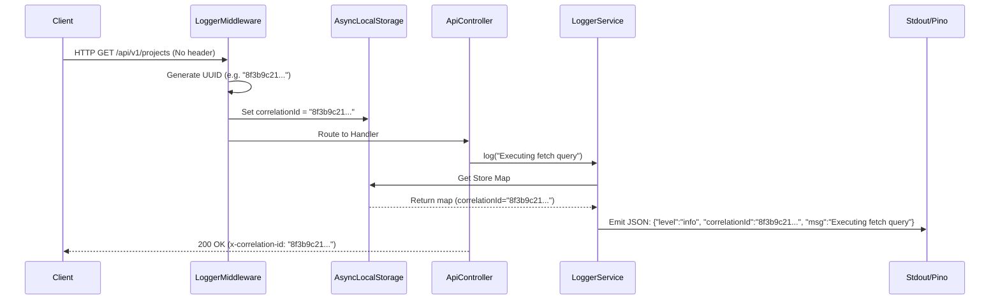

# TDD-002: Logger Module Technical Specification

## 1. Metadata & Status Block

| Metadata Field | Value |
| :--- | :--- |
| **Document ID** | TDD-002 |
| **Module Name** | LoggerModule |
| **Version** | v1.0.0 |
| **Status** | IMPLEMENTATION READY |
| **Lifecycle** | Reference |
| **Implementation Status** | Implemented |
| **Owner** | Unassigned |
| **Current Authority** | Level 9 — Technical design reference |
| **Last Verified** | 2026-07-31 |
| **EEP Phase Position** | Phase 1: Core Foundation & Cross-Cutting Concerns (Module 1.2) |
| **Exact Prerequisites** | [TDD-001](TDD-001_Config_Module.md) (ConfigModule) |

---

## 2. Technical Architecture Overview

The `LoggerModule` provides a highly performant, structured JSON logger wrapper based on Pino. It intercepts incoming HTTP requests, extracts or generates a unique correlation ID, and maintains structured metadata contexts throughout the asynchronous request execution lifecycle.

### File Placement Layout
```text
src/
└── server/
    └── shared/
        └── logger/
            ├── logger.module.ts        # NestJS Logger module
            ├── logger.middleware.ts    # Correlation ID extractor & Fastify hook
            ├── logger.service.ts       # Pino LoggerService wrapper
            └── constants.ts            # String token definitions
```

### Framework Integration Strategy
- **Framework Injection:** Implements the NestJS `LoggerService` interface. Instantiated in `main.ts` and passed to `NestFactory.create` to hijack default NestJS bootstrap and system logging:
  `const app = await NestFactory.create(AppModule, { logger: app.get(LoggerService) });`
- **Global Context Propagation:** Integrates with NestJS `AsyncLocalStorage` (or Pino's own storage binding mechanisms) to automatically attach the current correlation ID, project ID, and job ID to any log entry fired from downstream components without manual context propagation.

---

## 3. Interface & Contract Specification

### Correlation ID Request Context Middleware (`logger.middleware.ts`)
```typescript
import { Injectable, NestMiddleware } from '@nestjs/common';
import { FastifyRequest, FastifyReply } from 'fastify';
import { v4 as uuidv4 } from 'uuid';
import { AsyncLocalStorage } from 'async_hooks';

export const loggerStorage = new AsyncLocalStorage<Map<string, string>>();

@Injectable()
export class LoggerMiddleware implements NestMiddleware {
  use(req: FastifyRequest['raw'], res: FastifyReply['raw'], next: () => void) {
    const correlationId = (req.headers['x-correlation-id'] as string) || uuidv4();
    res.setHeader('x-correlation-id', correlationId);

    const contextMap = new Map<string, string>();
    contextMap.set('correlationId', correlationId);

    loggerStorage.run(contextMap, () => {
      next();
    });
  }
}
```

### Custom Logger Service Wrapper (`logger.service.ts`)
```typescript
import { Injectable, LoggerService as NestLoggerService } from '@nestjs/common';
import pino from 'pino';
import { ConfigService } from '../config/config.service';
import { loggerStorage } from './logger.middleware';

@Injectable()
export class LoggerService implements NestLoggerService {
  private readonly logger: pino.Logger;

  constructor(private readonly configService: ConfigService) {
    this.logger = pino({
      level: this.configService.get('LOG_LEVEL'),
      formatters: {
        level: (label) => ({ level: label }),
      },
      timestamp: pino.stdTimeFunctions.isoTime,
    });
  }

  private getContextMetadata(): Record<string, any> {
    const store = loggerStorage.getStore();
    if (!store) return {};
    return Object.fromEntries(store.entries());
  }

  log(message: any, context?: string) {
    const metadata = { ...this.getContextMetadata(), module: context };
    if (typeof message === 'object') {
      this.logger.info({ ...metadata, ...message });
    } else {
      this.logger.info(metadata, message);
    }
  }

  error(message: any, trace?: string, context?: string) {
    const metadata = { ...this.getContextMetadata(), module: context, err: trace };
    if (typeof message === 'object') {
      this.logger.error({ ...metadata, ...message });
    } else {
      this.logger.error(metadata, message);
    }
  }

  warn(message: any, context?: string) {
    const metadata = { ...this.getContextMetadata(), module: context };
    this.logger.warn(metadata, message);
  }

  debug(message: any, context?: string) {
    const metadata = { ...this.getContextMetadata(), module: context };
    this.logger.debug(metadata, message);
  }
}
```

---

## 4. Data & Schema Integration

- **Relational Tables Altered:** None.
- **Database Index Impact:** None.
- **Transactional State:** None. The log streaming engine writes logs directly to stdout/stderr in real-time.

---

## 5. Detailed Lifecycle & Error Matrix

### Correlation ID Injection & Tracing Lifecycle Flow



### Error Matrix

| Error Code / Name | Failure Type | Triggers / Condition | System Response / Recovery Action |
| :--- | :--- | :--- | :--- |
| Logging Write Failure | **FATAL** | Host process stdout stream is blocked or has insufficient permission. | Pino emits crash dump logs to stderr and terminates process execution. |
| Context Extraction Leak | Transient | `AsyncLocalStorage` is accessed outside an active middleware request scope. | Fallback logic catches lack of store and writes log lines without `correlationId` tracking metadata. |

---

## 6. Testing & Validation Criteria

### Unit Mocking Boundaries
- Mock `ConfigService` to pass configuration variables directly to the `LoggerService` constructor.
- Mock `loggerStorage` store maps using Vitest helpers to verify context propagation behaves as expected.

### Vitest Assertions
```typescript
import { describe, it, expect, vi, beforeEach } from 'vitest';
import { LoggerService } from './logger.service';
import { ConfigService } from '../config/config.service';
import { loggerStorage } from './logger.middleware';

describe('LoggerService', () => {
  let configService: ConfigService;
  let loggerService: LoggerService;

  beforeEach(() => {
    configService = {
      get: vi.fn().mockImplementation((key) => {
        if (key === 'LOG_LEVEL') return 'info';
        return undefined;
      }),
    } as any;
    loggerService = new LoggerService(configService);
  });

  it('should format logs as structured objects and include context metadata', () => {
    const mockPinoWrite = vi.spyOn((loggerService as any).logger, 'info');

    // Run logger within mock AsyncLocalStorage store
    const storeMap = new Map<string, string>([['correlationId', 'test-uuid-123']]);
    loggerStorage.run(storeMap, () => {
      loggerService.log('Application heartbeat event', 'SystemBootstrap');
    });

    expect(mockPinoWrite).toHaveBeenCalledWith(
      {
        correlationId: 'test-uuid-123',
        module: 'SystemBootstrap',
      },
      'Application heartbeat event'
    );
  });
});
```
