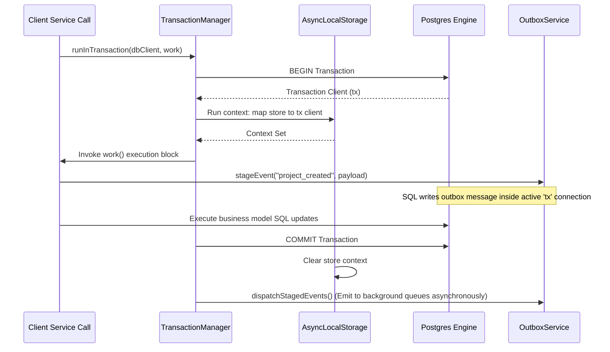

# TDD-003: Transaction Module Technical Specification

## 1. Metadata & Status Block

| Metadata Field | Value |
| :--- | :--- |
| **Document ID** | TDD-003 |
| **Module Name** | TransactionModule |
| **Version** | v1.0.0 |
| **Status** | IMPLEMENTATION READY |
| **EEP Phase Position** | Phase 1: Core Foundation & Cross-Cutting Concerns (Module 1.3) |
| **Exact Prerequisites** | [TDD-002](file:///c:/Users/Anmol/Desktop/rishi-ai/.docs/tdds/TDD-002_Logger_Module.md) (LoggerModule) |

---

## 2. Technical Architecture Overview

The `TransactionModule` establishes the database-transaction boundary using NestJS `AsyncLocalStorage` (ALS). It isolates SQL connection transactions cleanly, enabling downstream services to query the database within a shared atomic context without passing active database/transaction client references down the call stack.

### File Placement Layout
```text
src/
└── server/
    └── shared/
        └── transaction/
            ├── transaction.module.ts     # NestJS module declaration
            ├── transaction.manager.ts    # Central transaction executor (ALS wrapper)
            ├── transaction.interceptor.ts # NestJS HTTP transaction interceptor
            └── outbox/
                ├── outbox.service.ts     # Outbox dispatcher contract
                └── outbox-message.entity.ts # Core outbox entity schema reference
```

### Framework Injection Strategy
- **TransactionManager:** Registered as a globally injectable provider using `TransactionManager` token.
- **Drizzle Integration:** Binds Drizzle's database client directly within the storage engine to fetch and store active transaction clients in ALS storage buffers.

---

## 3. Interface & Contract Specification

### Transaction Manager Interface (`transaction.manager.ts`)
```typescript
import { Injectable } from '@nestjs/common';
import { AsyncLocalStorage } from 'async_hooks';

// Type representing the transactional database context client
export type DrizzleTransactionClient = any; // Will map to Drizzle's pg client transaction instance

@Injectable()
export class TransactionManager {
  private readonly als = new AsyncLocalStorage<DrizzleTransactionClient>();

  /**
   * Returns the current active transaction client if it exists in the storage window.
   */
  public getActiveClient(): DrizzleTransactionClient | null {
    return this.als.getStore() || null;
  }

  /**
   * Executes a function block within an atomic transaction.
   * If a transaction is already active, nests execution within it.
   */
  async runInTransaction<T>(
    dbClient: any, // The root DrizzleClient instance
    work: () => Promise<T>
  ): Promise<T> {
    const activeTx = this.getActiveClient();
    if (activeTx) {
      // Re-use current active transaction (Support nested executions)
      return work();
    }

    return await dbClient.transaction(async (tx: DrizzleTransactionClient) => {
      return this.als.run(tx, work);
    });
  }
}
```

### Deferred Transactional Outbox Interface (`outbox.service.ts`)
```typescript
export interface OutboxMessage {
  id: string;
  eventType: string;
  payload: Record<string, any>;
  createdAt: Date;
  processedAt?: Date;
}

export interface IOutboxService {
  /**
   * Stages a domain event payload to be persisted in the outbox table.
   * Execution MUST occur within the active transaction context managed by TransactionManager.
   */
  stageEvent(eventType: string, payload: Record<string, any>): Promise<void>;

  /**
   * Dispatches queued outbox records to the event stream after database commits.
   */
  dispatchStagedEvents(): Promise<void>;
}
```

---

## 4. Data & Schema Integration

- **Relational Tables Altered:** Implicitly interacts with the `outbox_messages` table (or project aggregate event tables) where events are staged within active database connections before committing.
- **Database Schema (Outbox reference):**
  ```typescript
  import { pgTable, uuid, text, timestamp, jsonb } from 'drizzle-orm/pg-core';

  export const outboxMessages = pgTable('outbox_messages', {
    id: uuid('id').primaryKey().defaultRandom(),
    eventType: text('event_type').notNull(),
    payload: jsonb('payload').default('{}').notNull(),
    createdAt: timestamp('created_at').defaultNow().notNull(),
    processedAt: timestamp('processed_at'),
  });
  ```

---

## 5. Detailed Lifecycle & Error Matrix

### Execution Context Lifecycle & Outbox Dispatch Flow



### Error Matrix

| Error Code / Name | Failure Type | Triggers / Condition | System Response / Recovery Action |
| :--- | :--- | :--- | :--- |
| Transaction Rollback | **FATAL** (for task) | Any SQL execution error or custom validation failure inside the transaction work block. | Automatically issues standard database `ROLLBACK` commands, cleans ALS, and bubbles the exception up the call stack. |
| Outbox Dispatch Drift | Transient | Network connectivity issues during domain event execution *after* transaction commit. | Staged outbox record remains in the database (processedAt is null) and is picked up by a background outbox recovery cron job. |

---

## 6. Testing & Validation Criteria

### Unit Mocking Boundaries
- Mock the Drizzle database client instance to verify its `.transaction` method executes correctly.
- Test that multiple concurrent calls correctly isolate transaction storage keys inside ALS.

### Vitest Assertions
```typescript
import { describe, it, expect, vi, beforeEach } from 'vitest';
import { TransactionManager } from './transaction.manager';

describe('TransactionManager', () => {
  let transactionManager: TransactionManager;
  let mockDbClient: any;

  beforeEach(() => {
    transactionManager = new TransactionManager();
    mockDbClient = {
      transaction: vi.fn().mockImplementation(async (callback) => {
        const mockTxClient = { name: 'mocked-drizzle-tx' };
        return callback(mockTxClient);
      }),
    };
  });

  it('should successfully run work inside active ALS context and commit transaction', async () => {
    let capturedClient: any = null;

    await transactionManager.runInTransaction(mockDbClient, async () => {
      capturedClient = transactionManager.getActiveClient();
    });

    expect(mockDbClient.transaction).toHaveBeenCalledTimes(1);
    expect(capturedClient).toEqual({ name: 'mocked-drizzle-tx' });
  });

  it('should reuse active transaction during nested runs', async () => {
    let innerCaptured: any = null;
    let outerCaptured: any = null;

    await transactionManager.runInTransaction(mockDbClient, async () => {
      outerCaptured = transactionManager.getActiveClient();
      await transactionManager.runInTransaction(mockDbClient, async () => {
        innerCaptured = transactionManager.getActiveClient();
      });
    });

    expect(mockDbClient.transaction).toHaveBeenCalledTimes(1); // Nested call does not start new transaction
    expect(outerCaptured).toBe(innerCaptured);
  });
});
```
