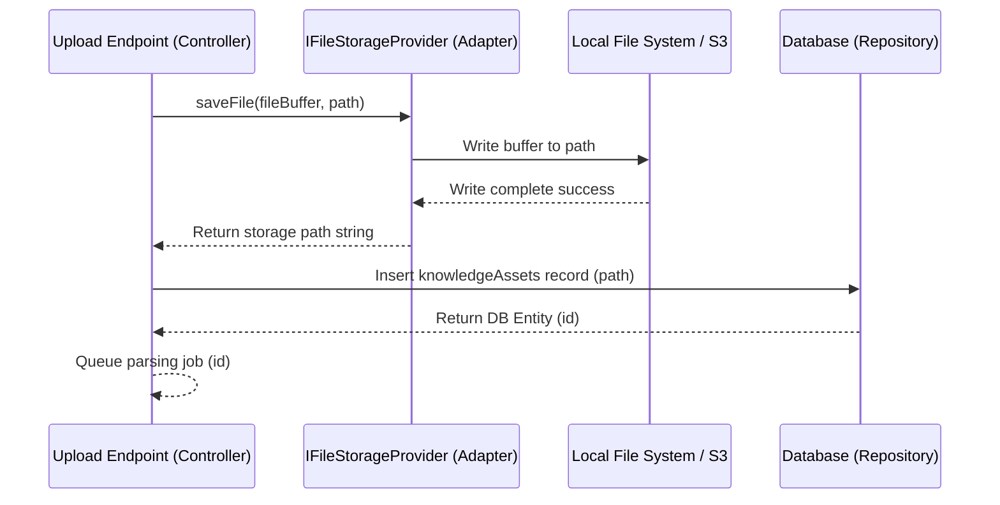

# TDD-005: Storage Module Technical Specification

## 1. Metadata & Status Block

| Metadata Field | Value |
| :--- | :--- |
| **Document ID** | TDD-005 |
| **Module Name** | StorageModule |
| **Version** | v1.0.0 |
| **Status** | IMPLEMENTATION READY |
| **EEP Phase Position** | Phase 2: Core Persistence & Shared Storage Suite (Module 2.2) |
| **Exact Prerequisites** | [TDD-001](file:///c:/Users/Anmol/Desktop/rishi-ai/.docs/tdds/TDD-001_Config_Module.md) (ConfigModule) |

---

## 2. Technical Architecture Overview

The `StorageModule` abstractly handles read, write, and deletion tasks targeting raw document uploads (PDFs, text files, markdown) and exported scripts. It decouples the core logic of the application from physical server disks and cloud storage API engines.

### File Placement Layout
```text
src/
└── server/
    └── shared/
        └── storage/
            ├── storage.module.ts            # NestJS storage configuration module
            ├── storage.provider.ts          # Provider registry routing (Local vs. Cloudflare R2)
            ├── interfaces/
            │   └── file-storage.provider.ts # Core abstract storage contract
            └── adapters/
                ├── local-storage.adapter.ts # Local disk adapter implementation
                └── s3-storage.adapter.ts    # AWS S3 / Cloudflare R2 adapter implementation
```

### Framework Integration Strategy
- **Injection Token:** Exposed via the abstract string token symbol `'IFileStorageProvider'`.
- **Conditional Factory Registration:** At module initialization, the provider checks the active `NODE_ENV` parameters. If running in `production`, it registers the S3/R2 adapter. Otherwise, it instantiates the local disk driver mapping to the workspace folder.

---

## 3. Interface & Contract Specification

### File Storage Provider Contract (`file-storage.provider.ts`)
```typescript
export interface IFileStorageProvider {
  /**
   * Saves a binary file buffer to the target path and returns the resolved storage URI.
   * Path should be relative (e.g. 'uploads/creator-uuid/asset-uuid.pdf').
   */
  saveFile(fileBuffer: Buffer, path: string): Promise<string>;

  /**
   * Retrieves a binary file buffer from the target storage location using its relative path.
   */
  getFile(path: string): Promise<Buffer>;

  /**
   * Permanently deletes a physical file asset from storage using its relative path.
   */
  deleteFile(path: string): Promise<void>;
}
```

### Local Storage Adapter Implementation (`local-storage.adapter.ts`)
```typescript
import { Injectable } from '@nestjs/common';
import { IFileStorageProvider } from '../interfaces/file-storage.provider';
import * as fs from 'fs/promises';
import * as path from 'path';

@Injectable()
export class LocalStorageAdapter implements IFileStorageProvider {
  private readonly baseDir = path.resolve(process.cwd(), 'storage');

  constructor() {
    // Eagerly ensure base storage directories exist
    fs.mkdir(this.baseDir, { recursive: true }).catch(() => {});
  }

  async saveFile(fileBuffer: Buffer, relativePath: string): Promise<string> {
    const fullPath = path.join(this.baseDir, relativePath);
    await fs.mkdir(path.dirname(fullPath), { recursive: true });
    await fs.writeFile(fullPath, fileBuffer);
    return relativePath;
  }

  async getFile(relativePath: string): Promise<Buffer> {
    const fullPath = path.join(this.baseDir, relativePath);
    return await fs.readFile(fullPath);
  }

  async deleteFile(relativePath: string): Promise<void> {
    const fullPath = path.join(this.baseDir, relativePath);
    await fs.unlink(fullPath).catch((err) => {
      if (err.code !== 'ENOENT') throw err; // Ignore if file already missing
    });
  }
}
```

---

## 4. Data & Schema Integration

- **Relational Tables Altered:** Relies on the `storage_path` text field in `knowledge_assets` tables to locate files.
- **Database Index Impact:** None.
- **Transactional State:** Files are written and fetched out-of-band relative to SQL transaction loops. Document uploads must be completed *before* DB records are committed.

---

## 5. Detailed Lifecycle & Error Matrix

### File Upload & Persistence Sequence



### Error Matrix

| Error Code / Name | Failure Type | Triggers / Condition | System Response / Recovery Action |
| :--- | :--- | :--- | :--- |
| File Write Failure | **FATAL** | Disk is out of space, write permissions are denied, or S3 network gateway is down. | Aborts upload sequence immediately, throws a `FileWriteException`, and prevents database insertion. |
| `ENOENT` (File Not Found) | Transient | Attempting to fetch a document that was deleted from local disk or S3 out-of-band. | Returns custom `FileNotFoundException` (allowing API controllers to return 404 cleanly). |

---

## 6. Testing & Validation Criteria

### Unit Mocking Boundaries
- Mock `fs/promises` operations for the `LocalStorageAdapter` tests to avoid creating garbage files during test execution.

### Vitest Assertions
```typescript
import { describe, it, expect, beforeEach, afterEach, vi } from 'vitest';
import { LocalStorageAdapter } from './adapters/local-storage.adapter';
import * as fs from 'fs/promises';
import * as path from 'path';

vi.mock('fs/promises');

describe('LocalStorageAdapter', () => {
  let adapter: LocalStorageAdapter;

  beforeEach(() => {
    vi.clearAllMocks();
    adapter = new LocalStorageAdapter();
  });

  it('should successfully write buffers to disk and return path', async () => {
    vi.spyOn(fs, 'writeFile').mockResolvedValue(undefined as any);
    vi.spyOn(fs, 'mkdir').mockResolvedValue(undefined as any);

    const relativePath = 'uploads/creator-1/doc-123.pdf';
    const result = await adapter.saveFile(Buffer.from('dummy data'), relativePath);

    expect(fs.mkdir).toHaveBeenCalled();
    expect(fs.writeFile).toHaveBeenCalledWith(expect.stringContaining(relativePath), expect.any(Buffer));
    expect(result).toBe(relativePath);
  });
});
```
