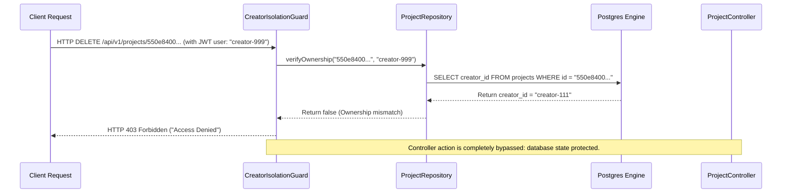

# TDD-007: Authorization Module Technical Specification

## 1. Metadata & Status Block

| Metadata Field | Value |
| :--- | :--- |
| **Document ID** | TDD-007 |
| **Module Name** | AuthorizationModule |
| **Version** | v1.0.0 |
| **Status** | COMPLETED |
| **Lifecycle** | Reference |
| **Implementation Status** | Implemented |
| **Owner** | Repository Maintainer |
| **Current Authority** | Level 9 — Technical design reference |
| **Last Verified** | 2026-07-31 |
| **EEP Phase Position** | Phase 3: Identity & Extensible Authorization (Module 3.2) |
| **Exact Prerequisites** | [TDD-006](TDD-006_Auth_Module.md) (AuthModule); [ADR-005](../adrs/ADR-005_authentication_identity_foundation.md) |

---

## 2. Technical Architecture Overview

The `AuthorizationModule` secures the multi-tenant perimeter of Rishi AI. It enforces the Non-Negotiable Context Isolation Invariant, blocking cross-user context exposure. The key mechanism is the `CreatorIsolationGuard` which runs at the NestJS HTTP routing layer, verifying that the authenticated creator profile matches the absolute owner of the requested Project or Knowledge Asset resources.

### File Placement Layout
```text
src/
└── server/
    └── shared/
        └── authorization/
            ├── authorization.module.ts # NestJS authorization configurations
            ├── guards/
            │   └── creator-isolation.guard.ts # Primary multi-tenant boundary guard
            └── decorators/
                └── current-creator.decorator.ts # Param extractor decorator
```

### Framework Integration Strategy
- **Perimeter Guarding:** Registered as a global guard or attached directly via `@UseGuards(CreatorIsolationGuard)` to API controllers handling project/asset mutations.
- **Resource Owner Resolver:** Intercepts route parameters (e.g. `projectId`, `assetId`), issues repository queries to extract owner information, and aborts routing sequences instantly if authentication ids fail containment tests.

---

## 3. Interface & Contract Specification

### Creator Isolation Guard Contract (`creator-isolation.guard.ts`)
```typescript
import { Injectable, CanActivate, ExecutionContext, ForbiddenException, BadRequestException } from '@nestjs/common';
import { Reflector } from '@nestjs/core';
import { FastifyRequest } from 'fastify';

export interface ISecuredRequest extends FastifyRequest {
  user: {
    id: string; // Authenticated Creator ID
    email: string;
  };
}

@Injectable()
export class CreatorIsolationGuard implements CanActivate {
  constructor(
    private readonly reflector: Reflector,
    private readonly projectRepository: any, // Injected project aggregate checker
    private readonly assetRepository: any   // Injected asset library checker
  ) {}

  async canActivate(context: ExecutionContext): Promise<boolean> {
    const request = context.switchToHttp().getRequest<ISecuredRequest>();
    const creatorId = request.user?.id;
    if (!creatorId) {
      return false; // Authentication token missing
    }

    const params = request.params as Record<string, string>;
    const projectId = params.projectId;
    const assetId = params.assetId;

    // 1. Validate Project Ownership Context
    if (projectId) {
      const isOwner = await this.projectRepository.verifyOwnership(projectId, creatorId);
      if (!isOwner) {
        throw new ForbiddenException('Access Denied: You do not own this project aggregate resource.');
      }
    }

    // 2. Validate Knowledge Asset Ownership Context
    if (assetId) {
      const isOwner = await this.assetRepository.verifyOwnership(assetId, creatorId);
      if (!isOwner) {
        throw new ForbiddenException('Access Denied: You do not own this knowledge asset library resource.');
      }
    }

    return true;
  }
}
```

---

## 4. Data & Schema Integration

- **Relational Tables Interacted:** `projects` and `knowledge_assets`.
- **Relational Constraint Verification:**
  - `projects.creator_id === request.user.id`
  - `knowledge_assets.creator_id === request.user.id`
- **Database Query Indexing Optimization:** Queries utilize the composite index `(creator_id, id)` on projects and assets to resolve ownership lookups in under 5ms.

---

## 5. Detailed Lifecycle & Error Matrix

### Request Isolation Guard Validation Loop



### Error Matrix

| Error Code / Name | Failure Type | Triggers / Condition | System Response / Recovery Action |
| :--- | :--- | :--- | :--- |
| `ForbiddenException` | **FATAL** (Request) | Valid user attempts to access a `projectId` owned by a different creator. | Immediately blocks pipeline execution and returns HTTP 403 Forbidden. |
| Missing Parameters | Transient | Route definition lacks `projectId` or `assetId` mapping tags. | Bypasses guard validation (falls back to basic JWT session checks). |

---

## 6. Testing & Validation Criteria

### Unit Mocking Boundaries
- Mock `projectRepository` and `assetRepository` to return specific boolean values for ownership matching scenarios.
- Stub the NestJS `ExecutionContext` payload to simulate requests containing verified user profiles.

### Vitest Assertions
```typescript
import { describe, it, expect, vi, beforeEach } from 'vitest';
import { CreatorIsolationGuard } from './guards/creator-isolation.guard';
import { ExecutionContext, ForbiddenException } from '@nestjs/common';

describe('CreatorIsolationGuard', () => {
  let guard: CreatorIsolationGuard;
  let mockProjectRepo: any;
  let mockAssetRepo: any;
  let mockReflector: any;

  beforeEach(() => {
    mockProjectRepo = { verifyOwnership: vi.fn() };
    mockAssetRepo = { verifyOwnership: vi.fn() };
    mockReflector = {};
    guard = new CreatorIsolationGuard(mockReflector as any, mockProjectRepo, mockAssetRepo);
  });

  it('should allow access if user owns the requested project', async () => {
    mockProjectRepo.verifyOwnership.mockResolvedValue(true);

    const mockContext = createMockContext('creator-1', { projectId: 'project-1' });
    const canActivate = await guard.canActivate(mockContext);

    expect(canActivate).toBe(true);
    expect(mockProjectRepo.verifyOwnership).toHaveBeenCalledWith('project-1', 'creator-1');
  });

  it('should throw ForbiddenException if user does not own the requested project', async () => {
    mockProjectRepo.verifyOwnership.mockResolvedValue(false);

    const mockContext = createMockContext('creator-1', { projectId: 'project-2' });

    await expect(guard.canActivate(mockContext)).rejects.toThrow(ForbiddenException);
  });

  function createMockContext(userId: string, params: Record<string, string>): ExecutionContext {
    return {
      switchToHttp: () => ({
        getRequest: () => ({
          user: { id: userId },
          params,
        }),
      }),
    } as any;
  }
});
```
