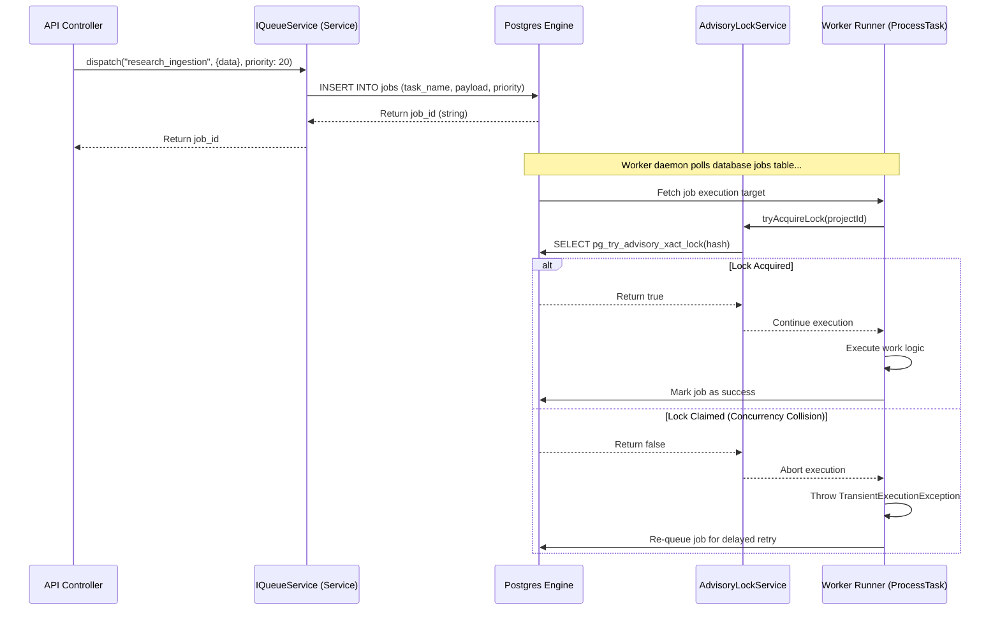

# TDD-008: Queue Module Technical Specification

## 1. Metadata & Status Block

| Metadata Field | Value |
| :--- | :--- |
| **Document ID** | TDD-008 |
| **Module Name** | QueueModule |
| **Version** | v1.0.0 |
| **Status** | IMPLEMENTATION READY |
| **EEP Phase Position** | Phase 4: Asynchronous Task Engine (Module 4.1) |
| **Exact Prerequisites** | [TDD-003](file:///c:/Users/Anmol/Desktop/rishi-ai/.docs/tdds/TDD-003_Transaction_Module.md) (TransactionModule), [TDD-004](file:///c:/Users/Anmol/Desktop/rishi-ai/.docs/tdds/TDD-004_Database_Module.md) (DatabaseModule) |

---

## 2. Technical Architecture Overview

The `QueueModule` processes resource-intensive tasks (embeddings compilation, document parsing, AI generation runs) out-of-band using a database-backed background job processor (default: `graphile-worker` running over PostgreSQL). It implements decorator-driven task routing and database advisory locks to serialize overlapping operations.

### File Placement Layout
```text
src/
└── server/
    └── shared/
        └── queue/
            ├── queue.module.ts         # NestJS queue setup & decorator discovery
            ├── queue.service.ts        # Dispatch implementation wrapping graphile-worker client
            ├── decorators/
            │   └── process-task.decorator.ts # Task worker binding decorator
            ├── explorer/
            │   └── queue.explorer.ts   # Metadata scanner compiling active listeners
            └── locks/
                └── advisory-lock.service.ts # Postgres advisory lock orchestrator
```

### Framework Integration Strategy
- **Interface Token Injection:** Exposed via `'IQueueService'` token.
- **Decorator Discovery:** Custom NestJS metadata explorer scans all injected providers on bootstrap. Any class method bearing `@ProcessTask('task_name')` is automatically extracted and bound to the worker routing table.
- **Graceful Shutdown:** Subscribes to NestJS `onApplicationShutdown` hooks, letting active workers finish current jobs (up to 15s timeout) and requeuing incomplete tasks before closing the pool.

---

## 3. Interface & Contract Specification

### Queue Service Interface (`queue.service.ts`)
```typescript
export interface JobPayloadVersionWrapper {
  payloadVersion: string;
  schemaVersion: string;
  data: Record<string, any>;
}

export interface IQueueService {
  /**
   * Enqueues a job payload to the backing database queue.
   * Priority levels: 0 (highest) to 100 (lowest).
   */
  dispatch(
    taskName: string,
    payload: JobPayloadVersionWrapper,
    priority?: number
  ): Promise<string>;
}
```

### Programmatic Task Decorator & Discovery Context (`process-task.decorator.ts`)
```typescript
import { SetMetadata } from '@nestjs/common';

export interface ProcessTaskOptions {
  concurrency?: number;
}

export const PROCESS_TASK_METADATA_KEY = 'PROCESS_TASK_METADATA';

/**
 * Decorator to declare a class method as a background task runner.
 */
export function ProcessTask(taskName: string, options: ProcessTaskOptions = {}) {
  return SetMetadata(PROCESS_TASK_METADATA_KEY, { taskName, ...options });
}
```

### Advisory Lock Interface (`advisory-lock.service.ts`)
```typescript
export interface IAdvisoryLockService {
  /**
   * Attempts to claim a non-blocking PostgreSQL advisory transaction lock for the uuid key.
   * Returns true if lock was successfully claimed, false otherwise.
   */
  tryAcquireLock(keyUuid: string): Promise<boolean>;
}
```

---

## 4. Data & Schema Integration

- **Relational Tables Interacted:** `graphile_worker.jobs` (or custom queue structures mapped inside the database).
- **PostgreSQL Advisory Locks Integration:**
  Uses transactional hashing locks to prevent concurrent runs on identical resources:
  ```sql
  SELECT pg_try_advisory_xact_lock(hashtouuid(:resourceId));
  ```
- **Job Status Tracking:** Updates status in the `generation_jobs` table when execution states transition.

---

## 5. Detailed Lifecycle & Error Matrix

### Task Dispatch & Worker Lifecycle Flow



### Error Matrix

| Error Code / Name | Failure Type | Triggers / Condition | System Response / Recovery Action |
| :--- | :--- | :--- | :--- |
| `TransientExecutionException` | Transient | Temporary API rate limits (429), DB connection drop, or advisory lock acquisition conflict. | Halts worker, schedules job retry using exponential backoff (e.g. 2^retryCount * 5s). |
| `FatalExecutionException` | **FATAL** | Payload schema validation failure, missing fields, or syntax error in parsing. | Immediately stops worker loops, flags job as `failed`, routes data to DLQ tracking tables, and notifications fire. |

---

## 6. Testing & Validation Criteria

### Unit Mocking Boundaries
- Mock `graphile-worker` runner client functions to assert correct payloads and prioritization parameters are passed during dispatching.
- Mock PostgreSQL advisory lock calls to simulate lock contention.

### Vitest Assertions
```typescript
import { describe, it, expect, vi, beforeEach } from 'vitest';
import { QueueService } from './queue.service';
import { AdvisoryLockService } from './locks/advisory-lock.service';

describe('AdvisoryLockService', () => {
  let lockService: AdvisoryLockService;
  let mockDbClient: any;

  beforeEach(() => {
    mockDbClient = {
      query: vi.fn(),
    };
    lockService = new AdvisoryLockService(mockDbClient);
  });

  it('should return true when advisory lock is successfully acquired', async () => {
    mockDbClient.query.mockResolvedValue({
      rows: [{ pg_try_advisory_xact_lock: true }],
    });

    const success = await lockService.tryAcquireLock('7c5e2a31-9b1b-4d7a-8f4b-3c7f9e0d2a4b');
    expect(success).toBe(true);
    expect(mockDbClient.query).toHaveBeenCalledWith(
      expect.stringContaining('pg_try_advisory_xact_lock'),
      expect.any(Array)
    );
  });

  it('should return false when advisory lock acquisition fails', async () => {
    mockDbClient.query.mockResolvedValue({
      rows: [{ pg_try_advisory_xact_lock: false }],
    });

    const success = await lockService.tryAcquireLock('7c5e2a31-9b1b-4d7a-8f4b-3c7f9e0d2a4b');
    expect(success).toBe(false);
  });
});
```
