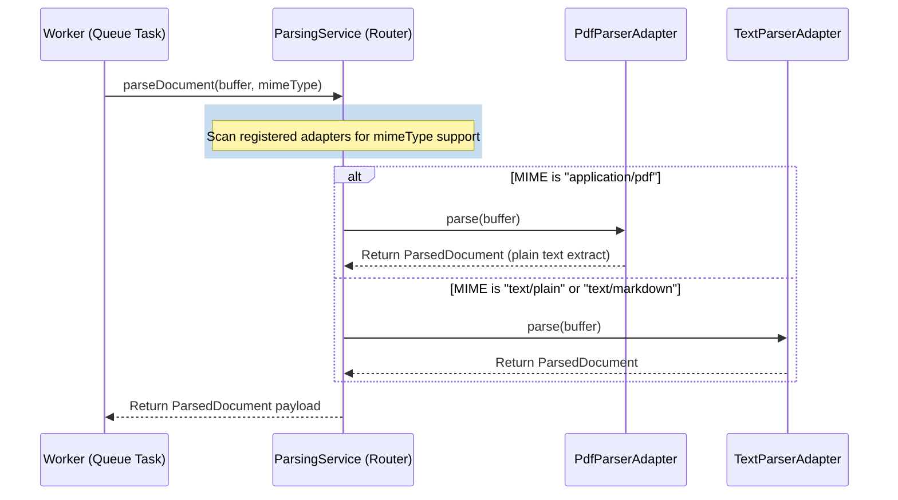

# TDD-009: Parsing Module Technical Specification

## 1. Metadata & Status Block

| Metadata Field | Value |
| :--- | :--- |
| **Document ID** | TDD-009 |
| **Module Name** | ParsingModule |
| **Version** | v1.0.0 |
| **Status** | COMPLETED |
| **Lifecycle** | Reference |
| **Implementation Status** | Implemented |
| **Owner** | Repository Maintainer |
| **Current Authority** | Level 9 — Technical design reference |
| **Last Verified** | 2026-07-31 |
| **EEP Phase Position** | Phase 5: Knowledge Curation & RAG Layer (Module 5.1) |
| **Exact Prerequisites** | [TDD-005](TDD-005_Storage_Module.md) (StorageModule), [TDD-007](TDD-007_Authorization_Module.md) (AuthorizationModule), [TDD-008](TDD-008_Queue_Module.md) (QueueModule) |

---

## 2. Technical Architecture Overview

The `ParsingModule` extracts text payloads from diverse file formats (PDF, DOCX, MD, HTML, EPUB, TXT) uploaded by creators. It utilizes a registry pattern to select the appropriate parser adapter based on the file MIME type, outputting normalized clean text records ready for vector curation.

### File Placement Layout
```text
src/
└── server/
    └── modules/
        └── knowledge/
            └── parsing/
                ├── parsing.module.ts       # NestJS parsing registration
                ├── parsing.service.ts      # Core router resolving parser adapters
                ├── interfaces/
                │   └── document-parser.ts  # Base parsing adapter interface
                └── adapters/
                    ├── pdf-parser.adapter.ts   # PDF extractor
                    ├── docx-parser.adapter.ts  # DOCX extractor
                    ├── html-parser.adapter.ts  # HTML extractor
                    ├── epub-parser.adapter.ts  # EPUB extractor
                    └── text-parser.adapter.ts  # Text/MD extractor
```

### Framework Integration Strategy
- **Ecosystem Registration:** Parser adapters register with the global `ParsingService` using custom decorators or provider injection bindings.
- **Provider Token Interface:** Exposed internally behind the `IDocumentParser` contract.

---

## 3. Interface & Contract Specification

### Document Parser Interface (`document-parser.ts`)
```typescript
export interface ParsedDocument {
  rawText: string;
  metadata: {
    pageCount?: number;
    wordCount: number;
    title?: string;
    extractedAuthor?: string;
    mimeType: string;
  };
}

export interface IDocumentParser {
  /**
   * Asserts whether this adapter can extract text from the target MIME type.
   */
  supportsMimeType(mimeType: string): boolean;

  /**
   * Parses the raw binary buffer of a file into a standardized text payload representation.
   */
  parse(fileBuffer: Buffer): Promise<ParsedDocument>;
}
```

### Core Parsing Router Service (`parsing.service.ts`)
```typescript
import { Injectable, UnsupportedMediaTypeException } from '@nestjs/common';
import { IDocumentParser, ParsedDocument } from './interfaces/document-parser';

@Injectable()
export class ParsingService {
  constructor(private readonly parsers: IDocumentParser[]) {}

  /**
   * Selects the correct parser based on MIME type and processes the raw file.
   */
  async parseDocument(fileBuffer: Buffer, mimeType: string): Promise<ParsedDocument> {
    const matchedParser = this.parsers.find((parser) => parser.supportsMimeType(mimeType));
    if (!matchedParser) {
      throw new UnsupportedMediaTypeException(`No parser registered for media type: ${mimeType}`);
    }

    return await matchedParser.parse(fileBuffer);
  }
}
```

---

## 4. Data & Schema Integration

- **Relational Tables Interacted:** Reads the `storage_path` from `knowledge_assets`. Text extracts are subsequently passed to the downstream chunking engine to update `knowledge_chunks`.
- **Database Index Impact:** None.
- **Transactional State:** None. Parsing occurs in worker memory context, outside of transactional blocks.

---

## 5. Detailed Lifecycle & Error Matrix

### Parsing Execution Routing Sequence



### Error Matrix

| Error Code / Name | Failure Type | Triggers / Condition | System Response / Recovery Action |
| :--- | :--- | :--- | :--- |
| `UnsupportedMediaTypeException` | **FATAL** | Creator uploads a file format (e.g. `.zip`, `.png`) which matches no registered parser. | Rejects task execution, flags the job as `failed` inside DB, and deletes temporary files. |
| Corruption Failure | **FATAL** | File is malformed, encrypted, password-protected, or corrupted during upload. | Parser library throws an extraction error, which is caught as a fatal background job failure. |

---

## 6. Testing & Validation Criteria

### Unit Mocking Boundaries
- Tests mock the individual adapters (`PdfParserAdapter`, `TextParserAdapter`) to isolate validation verification inside the central `ParsingService` router.

### Vitest Assertions
```typescript
import { describe, it, expect, vi, beforeEach } from 'vitest';
import { ParsingService } from './parsing.service';
import { IDocumentParser } from './interfaces/document-parser';
import { UnsupportedMediaTypeException } from '@nestjs/common';

describe('ParsingService', () => {
  let parsingService: ParsingService;
  let mockPdfParser: IDocumentParser;
  let mockTextParser: IDocumentParser;

  beforeEach(() => {
    mockPdfParser = {
      supportsMimeType: (mime) => mime === 'application/pdf',
      parse: vi.fn().mockResolvedValue({
        rawText: 'Extracted PDF text data content',
        metadata: { wordCount: 5, mimeType: 'application/pdf' },
      }),
    };

    mockTextParser = {
      supportsMimeType: (mime) => mime === 'text/plain',
      parse: vi.fn().mockResolvedValue({
        rawText: 'Simple text file contents',
        metadata: { wordCount: 4, mimeType: 'text/plain' },
      }),
    };

    parsingService = new ParsingService([mockPdfParser, mockTextParser]);
  });

  it('should successfully route to the correct parser based on MIME type', async () => {
    const result = await parsingService.parseDocument(Buffer.from('PDF_BYTES'), 'application/pdf');

    expect(result.rawText).toBe('Extracted PDF text data content');
    expect(mockPdfParser.parse).toHaveBeenCalled();
    expect(mockTextParser.parse).not.toHaveBeenCalled();
  });

  it('should throw UnsupportedMediaTypeException if no matching parser is found', async () => {
    await expect(
      parsingService.parseDocument(Buffer.from('PNG_BYTES'), 'image/png')
    ).rejects.toThrow(UnsupportedMediaTypeException);
  });
});
```
