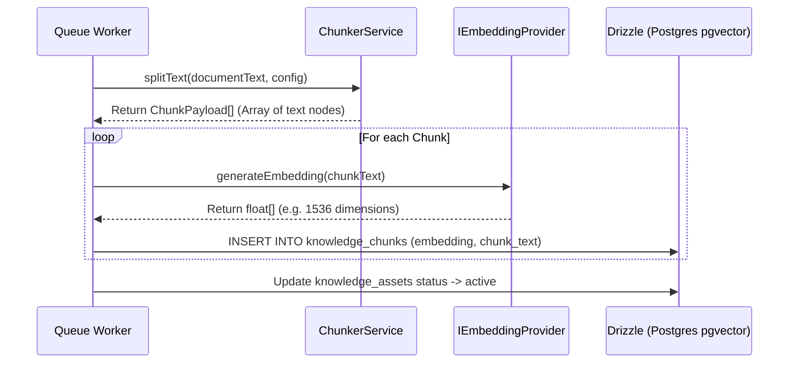

# TDD-010: Vector Curation Module Technical Specification

## 1. Metadata & Status Block

| Metadata Field | Value |
| :--- | :--- |
| **Document ID** | TDD-010 |
| **Module Name** | VectorCurationModule |
| **Version** | v1.0.0 |
| **Status** | IMPLEMENTATION READY |
| **EEP Phase Position** | Phase 5: Knowledge Curation & RAG Layer (Module 5.2) |
| **Exact Prerequisites** | [TDD-004](file:///c:/Users/Anmol/Desktop/rishi-ai/.docs/tdds/TDD-004_Database_Module.md) (DatabaseModule), [TDD-008](file:///c:/Users/Anmol/Desktop/rishi-ai/.docs/tdds/TDD-008_Queue_Module.md) (QueueModule), [TDD-009](file:///c:/Users/Anmol/Desktop/rishi-ai/.docs/tdds/TDD-009_Parsing_Module.md) (ParsingModule) |

---

## 2. Technical Architecture Overview

The `VectorCurationModule` coordinates text splitting routines, generates high-density embeddings using an abstract provider (`IEmbeddingProvider`), and maps semantic vectors directly to database tables. It executes cosine similarity search queries using the `pgvector` HNSW indexes compiled in the database layer.

### File Placement Layout
```text
src/
└── server/
    └── modules/
        └── knowledge/
            └── vector/
                ├── vector-curation.module.ts # NestJS module declaration
                ├── vector-curation.service.ts # Ingest orchestrator (Chunker -> Embedding -> DB)
                ├── embedding.provider.ts     # Adapter for embedding API (OpenAI/Gemini/Local)
                ├── chunker.service.ts         # Character/Token bounds text splitter
                └── search.service.ts          # pgvector query runner
```

### Framework Integration Strategy
- **Embedding Adapter Token:** Registered as `'IEmbeddingProvider'` allowing seamless swapping between model APIs (e.g. OpenAI `text-embedding-3-small` vs. Google `text-embedding-004`).
- **Asynchronous Execution:** Vector compilation is triggered as a background worker task dispatched through the `QueueService` to shield API response times from API network latency.

---

## 3. Interface & Contract Specification

### Embedding Provider Interface (`embedding.provider.ts`)
```typescript
export interface IEmbeddingProvider {
  /**
   * Translates plain scriptural text into a float array representation.
   */
  generateEmbedding(text: string): Promise<number[]>;

  /**
   * Returns the vector dimension mapping width constraint (e.g., 1536).
   */
  getDimension(): number;

  /**
   * Returns the active provider and model metadata.
   */
  getMetadata(): { provider: string; model: string; version: string };
}
```

### Chunker Splitter Interface (`chunker.service.ts`)
```typescript
export interface ChunkerConfig {
  maxTokenSize: number;
  overlapTokens: number;
}

export interface ChunkPayload {
  text: string;
  index: number;
  tokenCount: number;
}

@Injectable()
export class ChunkerService {
  /**
   * Splits a plain text payload into overlapping token chunks based on config parameters.
   */
  public splitText(text: string, config: ChunkerConfig): ChunkPayload[] {
    // Splits using character-token approximation or direct tokenizers
    // Returns chunk arrays containing start-end boundaries
    return []; 
  }
}
```

### Vector Search Interface (`search.service.ts`)
```typescript
export interface VectorSearchResult {
  chunkId: string;
  assetId: string;
  chunkText: string;
  cosineDistance: number;
  relevanceScore: number; // (1 - Cosine Distance) * 100
}

export interface ISearchService {
  /**
   * Queries pgvector snapshot chunks using cosine distance matching parameters.
   */
  querySemanticChunks(
    projectId: string,
    queryEmbedding: number[],
    limit: number
  ): Promise<VectorSearchResult[]>;
}
```

---

## 4. Data & Schema Integration

- **Relational Tables Interacted:** Inserts rows into `knowledge_chunks` and queries `snapshot_chunks`.
- **Drizzle pgvector Query Integration:**
  Queries utilize Drizzle's custom sql expressions to invoke cosine distance operators:
  ```typescript
  import { sql } from 'drizzle-orm';
  import { snapshotChunks } from '../../shared/database/schema';

  // Cosine distance operator is <=> in Postgres pgvector
  const queryDistance = sql`${snapshotChunks.embedding} <=> ${queryEmbedding}`;
  const results = await db
    .select({
      id: snapshotChunks.id,
      text: snapshotChunks.chunkText,
      distance: queryDistance,
    })
    .from(snapshotChunks)
    .orderBy(queryDistance)
    .limit(limit);
  ```

---

## 5. Detailed Lifecycle & Error Matrix

### Vector Curation & Parsing Process



### Error Matrix

| Error Code / Name | Failure Type | Triggers / Condition | System Response / Recovery Action |
| :--- | :--- | :--- | :--- |
| `EmbeddingApiException` | Transient | External API endpoint timeout (504) or rate limit exhausted (429). | Throws `TransientExecutionException`, initiating delayed queue task retry. |
| Dimension Mismatch | **FATAL** | Provider dimension (e.g., 384) does not match database schema constraint (e.g., 1536). | Database rejects insert transaction, aborting chunk generation immediately. |

---

## 6. Testing & Validation Criteria

### Unit Mocking Boundaries
- Mock `'IEmbeddingProvider'` API queries to return pre-compiled float arrays.
- Assert that `ChunkerService` generates correct overlap offsets.

### Vitest Assertions
```typescript
import { describe, it, expect, vi, beforeEach } from 'vitest';
import { ChunkerService } from './chunker.service';

describe('ChunkerService text splitting logic', () => {
  let chunker: ChunkerService;

  beforeEach(() => {
    chunker = new ChunkerService();
  });

  it('should generate correctly structured overlap chunk structures', () => {
    const longText = 'This is a long scriptural text translation block that needs partition.';
    const config = { maxTokenSize: 5, overlapTokens: 2 };

    const chunks = chunker.splitText(longText, config);

    // Verify chunk payloads structure is returned
    expect(chunks.length).toBeGreaterThan(0);
    expect(chunks[0]).toHaveProperty('chunkText');
    expect(chunks[0]).toHaveProperty('chunkIndex');
    expect(chunks[0]).toHaveProperty('tokenCount');
  });
});
```
