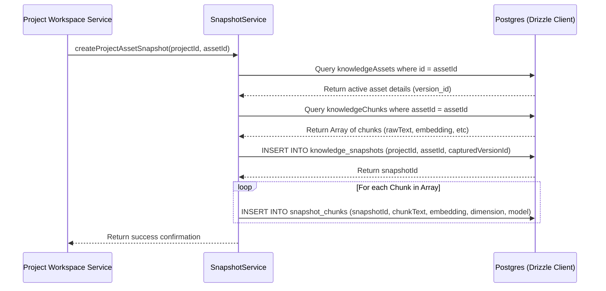

# TDD-011: Snapshot Module Technical Specification

## 1. Metadata & Status Block

| Metadata Field | Value |
| :--- | :--- |
| **Document ID** | TDD-011 |
| **Module Name** | SnapshotModule |
| **Version** | v1.0.0 |
| **Status** | IMPLEMENTATION READY |
| **Lifecycle** | Reference |
| **Implementation Status** | Partially Implemented |
| **Owner** | Unassigned |
| **Current Authority** | Level 9 — Technical design reference |
| **Last Verified** | 2026-07-31 |
| **EEP Phase Position** | Phase 5: Knowledge Curation & RAG Layer (Module 5.3) |
| **Exact Prerequisites** | [TDD-010](TDD-010_Vector_Curation_Module.md) (VectorCurationModule) |

---

## 2. Technical Architecture Overview

The `SnapshotModule` enforces the **Snapshot Preservation Policy** of Rishi AI. When a creator attaches a knowledge asset (reference text or style guide) to a project, this module creates an immutable, isolated duplicate of the asset's active chunks. This isolates the project's semantic context, ensuring future updates or deletions of library documents never corrupt or alter active project workflows.

### File Placement Layout
```text
src/
└── server/
    └── modules/
        └── knowledge/
            └── snapshot/
                ├── snapshot.module.ts       # NestJS module setup
                ├── snapshot.service.ts      # Orchestrator replicating chunks
                ├── repository/
                │   └── snapshot.repository.ts # Repository managing write-once transactions
                └── errors/
                    └── snapshot-immutable.exception.ts # Mutation blocker exception
```

### Framework Integration Strategy
- **Command-Side Replication:** Triggered inside the project workspace execution path when assets are mapped to a project container.
- **Write-Once Perimeter:** Repository contains no update SQL paths. If updates are attempted on snapshot entities, the service aborts execution.

---

## 3. Interface & Contract Specification

### Snapshot Service Contracts (`snapshot.service.ts`)
```typescript
export interface SnapshotCreationPayload {
  projectId: string;
  assetId: string;
}

export interface ISnapshotService {
  /**
   * Captures the active version of a knowledge asset, replicates all corresponding
   * knowledge_chunks, and writes them immutable-pinned into the snapshot tables.
   * Execution must execute inside a shared TransactionManager database block.
   */
  createProjectAssetSnapshot(payload: SnapshotCreationPayload): Promise<string>;

  /**
   * Removes a snapshot link when an asset is detached from a project.
   */
  removeProjectAssetSnapshot(projectId: string, snapshotId: string): Promise<void>;
}
```

---

## 4. Data & Schema Integration

- **Relational Tables Interacted:** Reads from `knowledge_assets` and `knowledge_chunks`. Inserts rows into `knowledge_snapshots` and `snapshot_chunks`.
- **Database Interrelation:**
  - `knowledge_snapshots`: Maps the foreign key `project_id` and the capturing `asset_id`.
  - `snapshot_chunks`: Clones `chunk_text`, `embedding`, `chunk_index`, and `token_count` from `knowledge_chunks` mapping them to the new `snapshot_id` parent.
- **Soft Delete Behavior:** Snapshots are immutable. They completely lack a `deleted_at` column.

---

## 5. Detailed Lifecycle & Error Matrix

### Snapshot Creation & Replication Lifecycle



### Error Matrix

| Error Code / Name | Failure Type | Triggers / Condition | System Response / Recovery Action |
| :--- | :--- | :--- | :--- |
| `SnapshotImmutableException` | **FATAL** | Downstream package triggers an UPDATE command targetting `knowledge_snapshots` or `snapshot_chunks`. | Code throws validation error, blocking execution before reaching database. |
| Incomplete Replication | **FATAL** | A database crash occurs mid-loop while inserting snapshot chunks. | The transaction rollback is triggered, reverting all inserts to prevent orphaned metadata records. |

---

## 6. Testing & Validation Criteria

### Unit Mocking Boundaries
- Mock `Drizzle` repository instances to ensure snapshot insertions occur in order.
- Assert that attempting to execute an update command on the repository throws an error.

### Vitest Assertions
```typescript
import { describe, it, expect, vi, beforeEach } from 'vitest';
import { SnapshotService } from './snapshot.service';
import { SnapshotImmutableException } from './errors/snapshot-immutable.exception';

describe('SnapshotService immutability validations', () => {
  let snapshotService: SnapshotService;
  let mockSnapshotRepo: any;
  let mockAssetRepo: any;

  beforeEach(() => {
    mockSnapshotRepo = {
      createSnapshotRecord: vi.fn().mockResolvedValue('snapshot-123'),
      replicateChunks: vi.fn(),
      update: vi.fn().mockRejectedValue(new SnapshotImmutableException('Snapshot objects cannot be modified')),
    };
    mockAssetRepo = {
      getActiveAsset: vi.fn(),
    };
    snapshotService = new SnapshotService(mockSnapshotRepo, mockAssetRepo);
  });

  it('should successfully replicate chunks into snapshot target tables', async () => {
    mockAssetRepo.getActiveAsset.mockResolvedValue({
      id: 'asset-1',
      versionId: 2,
      chunks: [{ chunkText: 'Vedic text chunk', chunkIndex: 1 }],
    });

    const snapshotId = await snapshotService.createProjectAssetSnapshot({
      projectId: 'project-1',
      assetId: 'asset-1',
    });

    expect(snapshotId).toBe('snapshot-123');
    expect(mockSnapshotRepo.createSnapshotRecord).toHaveBeenCalled();
    expect(mockSnapshotRepo.replicateChunks).toHaveBeenCalled();
  });

  it('should explicitly reject updates to snapshot tables', async () => {
    await expect(mockSnapshotRepo.update('snapshot-123', { text: 'modified' })).rejects.toThrow(
      SnapshotImmutableException
    );
  });
});
```
