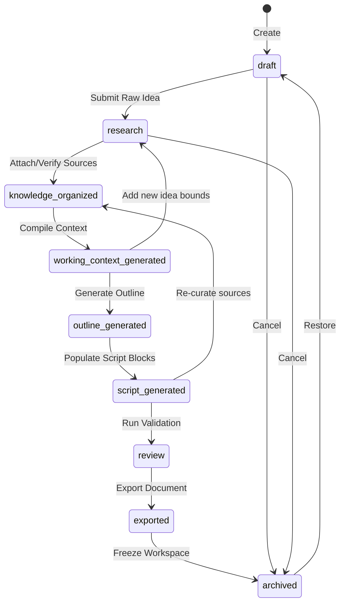

# TDD-012: Project Workspace Module Technical Specification

## 1. Metadata & Status Block

| Metadata Field | Value |
| :--- | :--- |
| **Document ID** | TDD-012 |
| **Module Name** | ProjectWorkspaceModule |
| **Version** | v1.0.0 |
| **Status** | IMPLEMENTATION READY |
| **Lifecycle** | Reference |
| **Implementation Status** | Partially Implemented |
| **Owner** | Unassigned |
| **Current Authority** | Level 9 — Technical design reference |
| **Last Verified** | 2026-07-31 |
| **EEP Phase Position** | Phase 6: Project Workspace & State Machine (Module 6.1) |
| **Exact Prerequisites** | [TDD-007](TDD-007_Authorization_Module.md) (AuthorizationModule), [TDD-011](TDD-011_Snapshot_Module.md) (SnapshotModule) |

---

## 2. Technical Architecture Overview

The `ProjectWorkspaceModule` serves as the primary aggregate container of Rishi AI. It governs project creations, configuration parameters, and structural updates. It implements the 9-stage State Machine lifecycle controls, using database optimistic locking to ensure concurrent updates from multiple asynchronous workers do not overwrite out-of-order edits.

### File Placement Layout
```text
src/
└── server/
    └── modules/
        └── projects/
            ├── projects.module.ts       # NestJS projects module container
            ├── projects.controller.ts   # Workspace route endpoints
            ├── projects.service.ts      # Workspace orchestrator & State Machine controller
            ├── repository/
            │   └── projects.repository.ts # Optimistic-lock repository driver
            └── errors/
                └── optimistic-lock.exception.ts # Database concurrency lock error
```

### Framework Integration Strategy
- **Isolation Protection:** Controller routes are bound to the `CreatorIsolationGuard` to ensure creators only edit their own workspace aggregates.
- **State Transition Guard:** The service layer intercepts all state mutation commands, verifying that requested target transitions match approved state transitions.

---

## 3. Interface & Contract Specification

### Project Lifecycle States (9-Stage State Machine)
```typescript
export type ProjectState =
  | 'draft'
  | 'research'
  | 'knowledge_organized'
  | 'working_context_generated'
  | 'outline_generated'
  | 'script_generated'
  | 'review'
  | 'exported'
  | 'archived';
```

### Project Workspace Service Interface (`projects.service.ts`)
```typescript
export interface CreateProjectDto {
  title: string;
}

export interface TransitionStateDto {
  targetState: ProjectState;
  expectedVersion: number; // For optimistic locking check
}

export interface IProjectsService {
  /**
   * Initializes a new project aggregate container inside the draft state.
   */
  createProject(creatorId: string, dto: CreateProjectDto): Promise<any>;

  /**
   * Evaluates and updates the active project state.
   * If expectedVersion is !== version in DB, throws OptimisticLockException.
   */
  transitionProjectState(
    projectId: string,
    creatorId: string,
    dto: TransitionStateDto
  ): Promise<void>;
}
```

---

## 4. Data & Schema Integration

- **Relational Tables Interacted:** `projects`.
- **Persistence Decoupling (Repository Pattern):**
  Persistence logic is isolated in `projects.repository.ts`. The service layer must interact with the database only through the `ProjectsRepository` class, avoiding direct schema or Drizzle imports in the service layer.
- **Projects Repository Interface (`projects.repository.ts`):**
  ```typescript
  export interface IProjectsRepository {
    create(creatorId: string, title: string): Promise<any>;
    findById(projectId: string): Promise<any>;
    updateStateWithLock(
      projectId: string,
      targetState: ProjectState,
      expectedVersion: number
    ): Promise<void>;
  }
  ```
- **Optimistic Locking Implementation:**
  Inside the `ProjectsRepository.updateStateWithLock` implementation, the database query verifies that the `version` matches `expectedVersion` and increments the version:
  ```typescript
  import { eq, and } from 'drizzle-orm';
  import { projects } from '../../shared/database/schema';

  // Inside ProjectsRepository:
  const updatedRows = await this.db
    .update(projects)
    .set({
      state: targetState,
      version: expectedVersion + 1,
      updatedAt: new Date(),
    })
    .where(
      and(
        eq(projects.id, projectId),
        eq(projects.version, expectedVersion)
      )
    )
    .returning();

  if (updatedRows.length === 0) {
    throw new OptimisticLockException(
      'Concurrency conflict: The project aggregate was updated by another process.'
    );
  }
  ```

---

## 5. Detailed Lifecycle & Error Matrix

### State Machine Transition Rules

The state transitions are governed by strict routing rules:
- **Sequential Progression:** `draft` -> `research` -> `knowledge_organized` -> `working_context_generated` -> `outline_generated` -> `script_generated` -> `review` -> `exported` -> `archived` (Normal Flow).
- **Backward Iteration:** A creator can explicitly step backward to edit parameters (e.g. from `script_generated` back to `knowledge_organized`). This is allowed, but triggers downstream context drift warnings.
- **Global Archival:** A workspace can transition to `archived` from any state.
- **Unarchiving:** Restores the project back to the state it occupied prior to archival.



### Error Matrix

| Error Code / Name | Failure Type | Triggers / Condition | System Response / Recovery Action |
| :--- | :--- | :--- | :--- |
| `OptimisticLockException` | **FATAL** (Request) | Concurrent update requests trigger updates using stale version indices. | Aborts operation, rolls back database transactions, and alerts user of conflict. |
| `InvalidStateTransitionException` | **FATAL** (Request) | Attempting to leap states out-of-order (e.g. from `draft` directly to `script_generated` without outlines). | Rejects state changes, returns HTTP 400 Bad Request. |

---

## 6. Testing & Validation Criteria

### Unit Mocking Boundaries
- Mock repository update returns to simulate row modifications and zero-row-update collisions.

### Vitest Assertions
```typescript
import { describe, it, expect, vi, beforeEach } from 'vitest';
import { ProjectsService } from './projects.service';
import { OptimisticLockException } from './errors/optimistic-lock.exception';

describe('ProjectsService state machine boundaries', () => {
  let service: ProjectsService;
  let mockProjectsRepo: any;

  beforeEach(() => {
    mockProjectsRepo = {
      getById: vi.fn(),
      updateStateOptimistic: vi.fn(),
    };
    service = new ProjectsService(mockProjectsRepo);
  });

  it('should successfully transition state when versions match', async () => {
    mockProjectsRepo.getById.mockResolvedValue({ id: 'project-1', state: 'draft', version: 1 });
    mockProjectsRepo.updateStateOptimistic.mockResolvedValue([{ id: 'project-1', state: 'research', version: 2 }]);

    await expect(
      service.transitionProjectState('project-1', 'creator-1', {
        targetState: 'research',
        expectedVersion: 1,
      })
    ).resolves.not.toThrow();

    expect(mockProjectsRepo.updateStateOptimistic).toHaveBeenCalledWith('project-1', 'research', 1);
  });

  it('should throw OptimisticLockException if repository returns zero rows updated', async () => {
    mockProjectsRepo.getById.mockResolvedValue({ id: 'project-1', state: 'draft', version: 2 }); // Stale version in cache
    mockProjectsRepo.updateStateOptimistic.mockResolvedValue([]); // Zero rows returned (conflict)

    await expect(
      service.transitionProjectState('project-1', 'creator-1', {
        targetState: 'research',
        expectedVersion: 1, // Sent stale expected index
      })
    ).rejects.toThrow(OptimisticLockException);
  });
});
```
