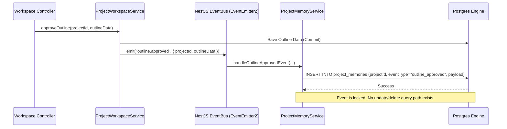

# TDD-013: Project Memory Module Technical Specification

## 1. Metadata & Status Block

| Metadata Field | Value |
| :--- | :--- |
| **Document ID** | TDD-013 |
| **Module Name** | ProjectMemoryModule |
| **Version** | v1.0.0 |
| **Status** | IMPLEMENTATION READY |
| **Lifecycle** | Reference |
| **Implementation Status** | Partially Implemented |
| **Owner** | Unassigned |
| **Current Authority** | Level 9 — Technical design reference |
| **Last Verified** | 2026-07-31 |
| **EEP Phase Position** | Phase 6: Project Workspace & State Machine (Module 6.2) |
| **Exact Prerequisites** | [TDD-012](TDD-012_Project_Workspace_Module.md) (ProjectWorkspaceModule) |

---

## 2. Technical Architecture Overview

The `ProjectMemoryModule` handles append-only log tracking. It records major workspace events, creator decisions, approved citations, context notes, and research summaries. It decouples long-term contextual memories from transient, volatile runtime parameters.

### File Placement Layout
```text
src/
└── server/
    └── modules/
        └── projects/
            └── memory/
                ├── project-memory.module.ts # NestJS module declaration
                ├── project-memory.service.ts # Event processing & logic handler
                └── repository/
                    └── project-memory.repository.ts # Append-only database driver
```

### Framework Integration Strategy
- **Append-Only Enforcement:** Repository exposes *only* write insertions (`logEvent`) and read selectors (`getHistory`). Update and delete operations are structurally missing from interfaces.
- **Event Bus Integration:** Subscribes to internal NestJS `EventEmitter2` event buses. When a project updates state, or block revisions occur, memory events automatically fire.

---

## 3. Interface & Contract Specification

### Project Memory Service Contracts (`project-memory.service.ts`)
```typescript
export interface MemoryEventPayload {
  projectId: string;
  eventType: string; // e.g. 'project_created', 'outline_approved', 'chunk_pinned'
  payload: Record<string, any>; // JSON structured metadata
}

export interface IProjectMemoryService {
  /**
   * Appends a new event record to the project's historical memory log.
   */
  recordMemory(event: MemoryEventPayload): Promise<void>;

  /**
   * Returns chronological logs for a project workspace.
   */
  getProjectMemoryLog(projectId: string): Promise<any[]>;
}
```

---

## 4. Data & Schema Integration

- **Relational Tables Interacted:** `project_memories`.
- **Database Interrelation:**
  - `project_memories.project_id` references `projects.id` with `onDelete: 'cascade'`.
  - `project_memories.event_type` and `project_memories.payload` store structured JSON values.
- **Write-Once Enforcement:** Since there is no soft delete or delete support on `project_memories`, raw database adapters throw database validation exceptions if a delete call is made.

---

## 5. Detailed Lifecycle & Error Matrix

### Append-Only Event Log Workflow



### Error Matrix

| Error Code / Name | Failure Type | Triggers / Condition | System Response / Recovery Action |
| :--- | :--- | :--- | :--- |
| `MemoryWriteException` | **FATAL** | Attempting to execute an update or delete query against the `project_memories` table. | Aborts command, raises runtime exception. |
| Invalid JSON Payload | **FATAL** | Passing raw strings or un-stringifiable cyclic objects into the payload column. | Serialization fails, JSON parser throws error, rejecting database insert. |

---

## 6. Testing & Validation Criteria

### Unit Mocking Boundaries
- Assert that calling `recordMemory` fires insert queries.
- Verify that historical logs are fetched chronologically (`orderBy(asc(createdAt))`).

### Vitest Assertions
```typescript
import { describe, it, expect, vi, beforeEach } from 'vitest';
import { ProjectMemoryService } from './project-memory.service';

describe('ProjectMemoryService event logging', () => {
  let service: ProjectMemoryService;
  let mockMemoryRepo: any;

  beforeEach(() => {
    mockMemoryRepo = {
      insertEvent: vi.fn().mockResolvedValue(true),
      getChronologicalEvents: vi.fn().mockResolvedValue([{ id: 'event-1', eventType: 'project_created' }]),
    };
    service = new ProjectMemoryService(mockMemoryRepo);
  });

  it('should successfully write events to the database', async () => {
    const payload = {
      projectId: 'project-1',
      eventType: 'project_created',
      payload: { title: 'Ancient Indian History' },
    };

    await expect(service.recordMemory(payload)).resolves.not.toThrow();
    expect(mockMemoryRepo.insertEvent).toHaveBeenCalledWith(payload);
  });

  it('should retrieve events chronologically sorted', async () => {
    const history = await service.getProjectMemoryLog('project-1');

    expect(history).toHaveLength(1);
    expect(history[0].eventType).toBe('project_created');
    expect(mockMemoryRepo.getChronologicalEvents).toHaveBeenCalledWith('project-1');
  });
});
```
