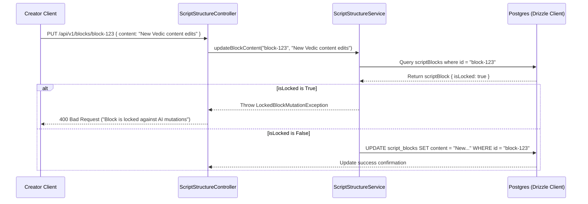

# TDD-014: Script Structure Module Technical Specification

## 1. Metadata & Status Block

| Metadata Field | Value |
| :--- | :--- |
| **Document ID** | TDD-014 |
| **Module Name** | ScriptStructureModule |
| **Version** | v1.0.0 |
| **Status** | IMPLEMENTATION READY |
| **EEP Phase Position** | Phase 6: Project Workspace & State Machine (Module 6.3) |
| **Exact Prerequisites** | [TDD-012](file:///c:/Users/Anmol/Desktop/rishi-ai/.docs/tdds/TDD-012_Project_Workspace_Module.md) (ProjectWorkspaceModule) |

---

## 2. Technical Architecture Overview

The `ScriptStructureModule` implements the **Script Block Architecture** of Rishi AI. Rather than managing scripts as massive, unstructured text blocks, scripts are organized into sequential, modular script blocks. This allows targeted AI regenerations and manual edits on independent chapters while preserving the surrounding layout positions.

### File Placement Layout
```text
src/
└── server/
    └── modules/
        └── projects/
            └── script/
                ├── script-structure.module.ts # NestJS module declaration
                ├── script-structure.controller.ts # Script block API endpoints
                ├── script-structure.service.ts # Rearranging & lock controllers
                └── repository/
                    └── script-blocks.repository.ts # Order-aware Drizzle repository
```

### Framework Integration Strategy
- **Sequence Rearranger:** Exposes specialized commands for moving blocks up/down in the sequence array.
- **Privacy Lock Guards:** Exposes toggles to set `is_locked = true`. When set, AI processing modules are prohibited from overwriting block text.

---

## 3. Interface & Contract Specification

### Script Block Interfaces (`script-structure.service.ts`)
```typescript
export interface CreateBlockDto {
  title: string;
  sortOrder: number;
}

export interface ReorderBlocksDto {
  blockIdsInOrder: string[]; // Ordered list of UUIDs
}

export interface IScriptStructureService {
  /**
   * Appends a new block metadata holder to the script index.
   */
  createBlock(projectId: string, dto: CreateBlockDto): Promise<any>;

  /**
   * Updates block text content. If block is_locked === true, throws LockedBlockMutationException.
   */
  updateBlockContent(blockId: string, content: string): Promise<void>;

  /**
   * Toggles the block's is_locked attribute, guarding it from AI rewrites.
   */
  toggleBlockLock(blockId: string, isLocked: boolean): Promise<void>;

  /**
   * Reorders the script block layout array sequentially matching order list array.
   * Runs atomically inside TransactionManager bounds.
   */
  reorderScriptBlocks(projectId: string, dto: ReorderBlocksDto): Promise<void>;
}
```

---

## 4. Data & Schema Integration

- **Relational Tables Interacted:** `script_blocks`.
- **Database Interrelation:**
  - `script_blocks.project_id` references `projects.id` with `onDelete: 'cascade'`.
  - `script_blocks.sort_order` is an integer tracking relative array position.
- **Query Optimization Index:** B-Tree index on `(project_id, sort_order)` speeds up sequential fetches:
  ```typescript
  import { eq, asc } from 'drizzle-orm';
  import { scriptBlocks } from '../../shared/database/schema';

  const orderedBlocks = await db
    .select()
    .from(scriptBlocks)
    .where(eq(scriptBlocks.projectId, projectId))
    .orderBy(asc(scriptBlocks.sortOrder));
  ```

---

## 5. Detailed Lifecycle & Error Matrix

### Script Block Locking & Ordering Workflow



### Error Matrix

| Error Code / Name | Failure Type | Triggers / Condition | System Response / Recovery Action |
| :--- | :--- | :--- | :--- |
| `LockedBlockMutationException` | **FATAL** (Request) | Attempting to execute an AI regeneration command on a block where `isLocked` is true. | Blocks update logic, prevents LLM execution calls, and returns validation failures. |
| Sort Ordering Collision | Transient | Two concurrent user requests attempt to update order sequence array indices. | Drizzle query fails, or transaction manager forces a rollback to prevent index holes. |

---

## 6. Testing & Validation Criteria

### Unit Mocking Boundaries
- Stub `script-blocks.repository` outputs to verify lock checking logic blocks mutations correctly.
- Verify sorting lists update the `sort_order` integer incrementing logically from 0 without gaps.

### Vitest Assertions
```typescript
import { describe, it, expect, vi, beforeEach } from 'vitest';
import { ScriptStructureService } from './script-structure.service';
import { LockedBlockMutationException } from './errors/locked-block-mutation.exception';

describe('ScriptStructureService block lock validation', () => {
  let service: ScriptStructureService;
  let mockBlocksRepo: any;

  beforeEach(() => {
    mockBlocksRepo = {
      getBlockById: vi.fn(),
      updateContent: vi.fn(),
    };
    service = new ScriptStructureService(mockBlocksRepo);
  });

  it('should successfully update content on an unlocked block', async () => {
    mockBlocksRepo.getBlockById.mockResolvedValue({ id: 'block-1', isLocked: false });

    await expect(service.updateBlockContent('block-1', 'valid script line')).resolves.not.toThrow();
    expect(mockBlocksRepo.updateContent).toHaveBeenCalledWith('block-1', 'valid script line');
  });

  it('should throw LockedBlockMutationException when updating a locked block', async () => {
    mockBlocksRepo.getBlockById.mockResolvedValue({ id: 'block-2', isLocked: true });

    await expect(service.updateBlockContent('block-2', 'ai edit attempt')).rejects.toThrow(
      LockedBlockMutationException
    );
    expect(mockBlocksRepo.updateContent).not.toHaveBeenCalled();
  });
});
```
