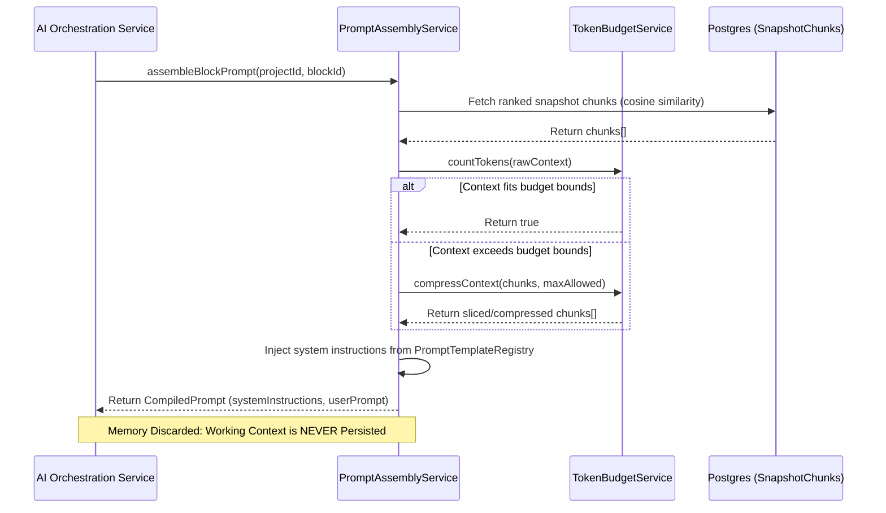

# TDD-015: Prompt Assembly Module Technical Specification

## 1. Metadata & Status Block

| Metadata Field | Value |
| :--- | :--- |
| **Document ID** | TDD-015 |
| **Module Name** | PromptAssemblyModule |
| **Version** | v1.0.0 |
| **Status** | IMPLEMENTATION READY |
| **Lifecycle** | Reference |
| **Implementation Status** | Planned |
| **Owner** | Unassigned |
| **Current Authority** | Level 9 — Technical design reference |
| **Last Verified** | 2026-07-31 |
| **EEP Phase Position** | Phase 7: AI Orchestration Subsystem (Module 7.1) |
| **Exact Prerequisites** | [TDD-010](TDD-010_Vector_Curation_Module.md) (VectorCurationModule), [TDD-013](TDD-013_Project_Memory_Module.md) (ProjectMemoryModule) |

---

## 2. Technical Architecture Overview

The `PromptAssemblyModule` coordinates prompt generation. It executes the **Working Context Principle**, extracting relevant reference text fragments and historical user decisions in volatile memory. It applies dynamic token constraint rules, dropping lower-ranked reference chunks if payload bounds are breached, preventing context window failures during inference.

### File Placement Layout
```text
src/
└── server/
    └── modules/
        └── prompt/
            ├── prompt-assembly.module.ts # NestJS module declaration
            ├── prompt-assembly.service.ts # Core pipeline assembler
            ├── registry/
            │   └── prompt-template.registry.ts # Centralized prompt system instructions
            └── token/
                └── token-budget.service.ts # Tiktoken-based counter & compression engine
```

### Framework Integration Strategy
- **Volatile Execution:** Raw assembled prompts are materialized as transient memory structures. Compiled prompts are **never** persisted to database tables, reducing indexing costs and ensuring security.
- **Provider Token:** Injected into downstream generation tasks via `PromptAssemblyService`.

---

## 3. Interface & Contract Specification

### Assembled Prompt Contract (`prompt-assembly.service.ts`)
```typescript
export interface CompiledPrompt {
  systemInstructions: string;
  userPrompt: string;
  tokenCount: number;
}

export interface IPromptAssemblyService {
  /**
   * Compiles context arrays, runs token compression, injects template instructions,
   * and returns the final transient prompt payload.
   */
  assembleBlockPrompt(
    projectId: string,
    blockId: string,
    rawQuery: string
  ): Promise<CompiledPrompt>;
}
```

### Prompt Template Registry Interface (`prompt-template.registry.ts`)
```typescript
export interface PromptTemplate {
  templateName: string;
  version: string;
  systemInstructions: string;
  baseUserTemplate: string;
}

export interface IPromptTemplateRegistry {
  /**
   * Retrieves a validated prompt template by name and version.
   */
  getTemplate(name: string, version?: string): PromptTemplate;
}
```

### Token Budget Service Interface (`token-budget.service.ts`)
```typescript
export interface TokenBudgetConfig {
  maxLimit: number; // e.g. 8192 tokens
  reservedForCompletion: number; // e.g. 2048 tokens
}

export interface ITokenBudgetService {
  /**
   * Counts tokens in a string.
   */
  countTokens(text: string): number;

  /**
   * Compresses context items by ranking if total count exceeds the budget threshold.
   */
  compressContext<T>(
    items: T[],
    textExtractor: (item: T) => string,
    maxAllowedTokens: number
  ): T[];
}
```

---

## 4. Data & Schema Integration

- **Relational Tables Interacted:** None. All processing and parsing loops run strictly in volatile memory.
- **Database Interrelation:** Reads from `snapshot_chunks` and `project_memories` to build contexts, but never writes data back.

---

## 5. Detailed Lifecycle & Error Matrix

### Ephemeral Prompt Assembly Pipeline



### Error Matrix

| Error Code / Name | Failure Type | Triggers / Condition | System Response / Recovery Action |
| :--- | :--- | :--- | :--- |
| `TokenBudgetOverflowException` | **FATAL** | Context is too large and cannot be compressed below the model limits. | Aborts generation run, records failure to `generation_jobs`, and alerts creator to reduce sources. |
| Template Registry Lookup Error | **FATAL** | System requests a template tag (e.g. `outline_v2`) that is missing from registry. | Halts compilation, throws configuration exception. |

---

## 6. Testing & Validation Criteria

### Unit Mocking Boundaries
- Mock `TokenBudgetService` token counts to verify compression logic slices items correctly.
- Test that prompt outputs contain citation hooks mapping to `snapshot_chunk_id` tags.

### Vitest Assertions
```typescript
import { describe, it, expect, vi, beforeEach } from 'vitest';
import { TokenBudgetService } from './token/token-budget.service';

describe('TokenBudgetService context compression', () => {
  let budgetService: TokenBudgetService;

  beforeEach(() => {
    budgetService = new TokenBudgetService();
  });

  it('should compress context blocks when token count exceeds budget limits', () => {
    const contextItems = [
      { text: 'First high relevance chunk text', rank: 1 },
      { text: 'Second relevance chunk', rank: 2 },
      { text: 'Third relevance chunk', rank: 3 },
    ];

    // Mock countTokens: first chunk = 10 tokens, others = 5 tokens.
    vi.spyOn(budgetService, 'countTokens').mockImplementation((text) => {
      if (text.includes('First')) return 10;
      return 5;
    });

    const compressed = budgetService.compressContext(
      contextItems,
      (item) => item.text,
      12 // Only space for the first chunk (10 tokens)
    );

    expect(compressed).toHaveLength(1);
    expect(compressed[0].rank).toBe(1);
  });
});
```
