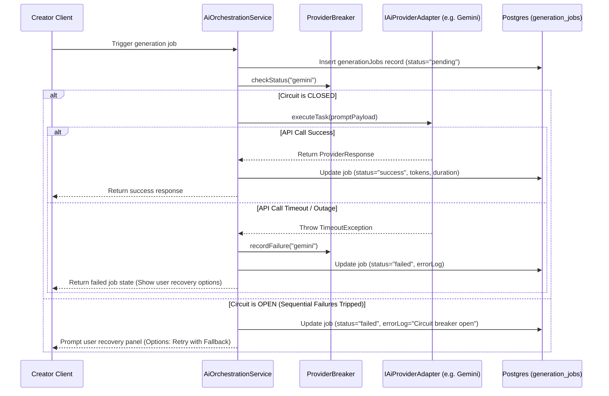

# TDD-016: AI Orchestration Module Technical Specification

## 1. Metadata & Status Block

| Metadata Field | Value |
| :--- | :--- |
| **Document ID** | TDD-016 |
| **Module Name** | AiOrchestrationModule |
| **Version** | v1.0.0 |
| **Status** | IMPLEMENTATION READY |
| **EEP Phase Position** | Phase 7: AI Orchestration Subsystem (Module 7.2) |
| **Exact Prerequisites** | [TDD-008](file:///c:/Users/Anmol/Desktop/rishi-ai/.docs/tdds/TDD-008_Queue_Module.md) (QueueModule), [TDD-015](file:///c:/Users/Anmol/Desktop/rishi-ai/.docs/tdds/TDD-015_Prompt_Assembly_Module.md) (PromptAssemblyModule) |

---

## 2. Technical Architecture Overview

The `AiOrchestrationModule` serves as the gateway to external Large Language Models (Gemini, OpenAI, Ollama, DeepSeek). It implements interchangeable adapter classes matching a standard contract, wrapping provider-specific SDKs. It coordinates circuit-breaker status checks to block failing APIs, routing requests to local fallbacks (e.g. Ollama) when thresholds are breached, and manages user-facing job failure states to track recovery actions manually.

### File Placement Layout
```text
src/
└── server/
    └── modules/
        └── execution/
            ├── ai-orchestration.module.ts # NestJS execution setup
            ├── ai-orchestration.service.ts # Core coordinator dispatching jobs
            ├── interfaces/
            │   └── ai-provider.adapter.ts  # Standard provider contract
            ├── adapters/
            │   ├── gemini.adapter.ts       # Gemini API client wrapper
            │   ├── openai.adapter.ts       # OpenAI API client wrapper
            │   └── ollama.adapter.ts       # Local Ollama client wrapper
            └── circuit-breaker/
                └── provider-breaker.ts     # In-memory circuit breaker manager
```

### Framework Integration Strategy
- **Adapter Factory Registry:** Resolves the active provider adapter dynamically from the string injection token `'IAiProviderAdapter'`.
- **Fault Tolerance:** If calls to the primary provider timeout sequentially, the `ProviderBreaker` trips. The orchestrator logs trace events to the `generation_jobs` audit trail, notifies the client thread, and redirects background tasks to local fallback endpoints as per configuration rules.

---

## 3. Interface & Contract Specification

### AI Provider Adapter Interface (`ai-provider.adapter.ts`)
```typescript
export interface PromptPayload {
  systemInstructions: string;
  userPrompt: string;
  temperature: number;
  maxTokens?: number;
}

export interface ProviderResponse {
  rawOutput: string;
  promptTokens: number;
  completionTokens: number;
  modelName: string;
  providerName: string;
}

export interface IAiProviderAdapter {
  /**
   * Executes a prompt call using the provider SDK.
   */
  executeTask(payload: PromptPayload): Promise<ProviderResponse>;
}
```

### AI Orchestration Service Interface (`ai-orchestration.service.ts`)
```typescript
export interface GenerationJobPayload {
  projectId: string;
  blockId: string;
  templateName: string;
  providerName: string;
}

export interface IAiOrchestrationService {
  /**
   * Dispatches a generation task, monitors execution, tracks costs,
   * updates the generationJobs tables, and handles retry/recovery workflows.
   */
  executeGenerationJob(payload: GenerationJobPayload): Promise<string>;

  /**
   * Resolves a failed job state via user actions: retry, switch provider, or cancel.
   */
  handleUserRecoveryAction(
    jobId: string,
    action: 'retry' | 'switch_provider' | 'cancel',
    fallbackProvider?: string
  ): Promise<void>;
}
```

---

## 4. Data & Schema Integration

- **Relational Tables Interacted:** `generation_jobs`.
- **Job Status Tracking:** Mutates `generation_jobs` status columns across `pending`, `processing`, `success`, and `failed` enums.
- **Cost Auditing Metric Columns:** Stores `prompt_tokens`, `completion_tokens`, and `estimated_cost_usd` inside the database following success completions.

---

## 5. Detailed Lifecycle & Error Matrix

### AI Generation & Failure Recovery Lifecycle



### User Failover Recovery Rules
- **Non-User-Facing Background Tasks:** The orchestrator switches providers automatically if the primary provider breaker trips.
- **User-Facing Interventions:** If an active stream or generation fails, the job remains associated with the failing provider until the user intervenes:
  1. **Retry:** Triggers retry attempt on identical provider (e.g., if transient 429).
  2. **Switch Provider:** Re-routes the job payload to a secondary fallback provider.
  3. **Cancel:** Aborts the task, cleaning up pending buffers.

### Error Matrix

| Error Code / Name | Failure Type | Triggers / Condition | System Response / Recovery Action |
| :--- | :--- | :--- | :--- |
| `ProviderBreakerException` | Transient | Primary API is locked because the circuit breaker tripped due to consecutive timeouts. | Re-routes background task requests to fallback endpoints (Ollama). |
| `429` (Rate Limit) | Transient | Provider limits exceeded. | Halts worker, sleeps execution thread, and retries using queue retry configurations. |

---

## 6. Testing & Validation Criteria

### Unit Mocking Boundaries
- Stub adapter instances to simulate API call failures, response timeouts, and correct token metric outputs.
- Test `ProviderBreaker` trip limits by executing mock requests sequentially.

### Vitest Assertions
```typescript
import { describe, it, expect, vi, beforeEach } from 'vitest';
import { ProviderBreaker } from './circuit-breaker/provider-breaker';

describe('ProviderBreaker circuit tripping', () => {
  let breaker: ProviderBreaker;

  beforeEach(() => {
    breaker = new ProviderBreaker({
      failureThreshold: 2,
      cooldownMs: 1000,
    });
  });

  it('should transition to OPEN state after sequential failures', () => {
    expect(breaker.canExecute('gemini')).toBe(true);

    breaker.recordFailure('gemini');
    expect(breaker.canExecute('gemini')).toBe(true);

    breaker.recordFailure('gemini'); // Reaches threshold
    expect(breaker.canExecute('gemini')).toBe(false); // Tripped
  });

  it('should reset to CLOSED state after cooldown period expires', async () => {
    breaker.recordFailure('gemini');
    breaker.recordFailure('gemini');
    expect(breaker.canExecute('gemini')).toBe(false);

    // Sleep for cooldown
    await new Promise((resolve) => setTimeout(resolve, 1100));

    expect(breaker.canExecute('gemini')).toBe(true); // Cooldown expired, allows test query
  });
});
```
