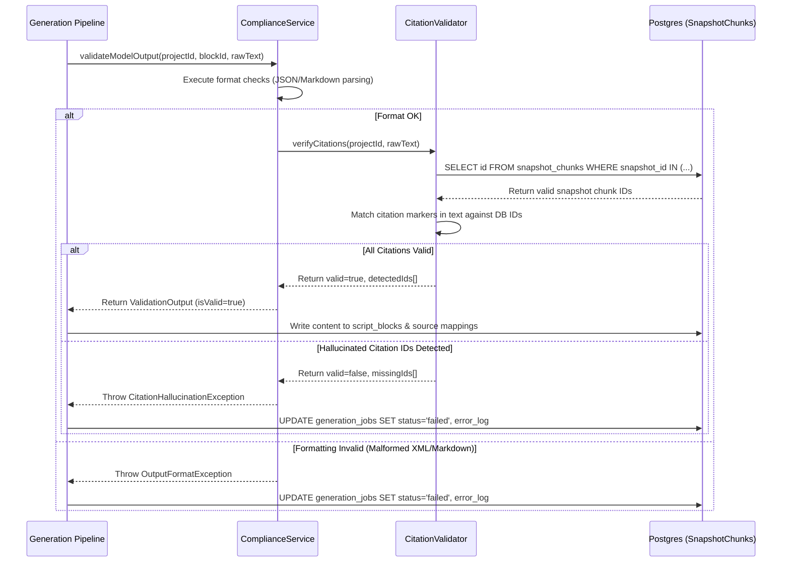

# TDD-017: Compliance Validation Module Technical Specification

## 1. Metadata & Status Block

| Metadata Field | Value |
| :--- | :--- |
| **Document ID** | TDD-017 |
| **Module Name** | ComplianceValidationModule |
| **Version** | v1.0.0 |
| **Status** | IMPLEMENTATION READY |
| **Lifecycle** | Reference |
| **Implementation Status** | Planned |
| **Owner** | Unassigned |
| **Current Authority** | Level 9 — Technical design reference |
| **Last Verified** | 2026-07-31 |
| **EEP Phase Position** | Phase 7: AI Orchestration Subsystem (Module 7.3) |
| **Exact Prerequisites** | [TDD-014](TDD-014_Script_Structure_Module.md) (ScriptStructureModule), [TDD-016](TDD-016_AI_Orchestration_Module.md) (AiOrchestrationModule) |

---

## 2. Technical Architecture Overview

The `ComplianceValidationModule` serves as the post-AI validation gate. Before text content returned from external model systems updates our primary table schemas, it verifies that raw outputs match formatting constraints, check-guards missing fields, and asserts that citations correspond to valid snapshot IDs, rolling back operations if validation checks fail.

### File Placement Layout
```text
src/
└── server/
    └── modules/
        └── execution/
            └── compliance/
                ├── compliance.module.ts       # NestJS compliance configuration
                ├── compliance.service.ts      # Verifier orchestrator
                └── validators/
                    ├── format.validator.ts    # JSON or Markdown schema verifier
                    └── citation.validator.ts  # Citation integrity checker
```

### Framework Integration Strategy
- **Orchestration Interceptor:** Called in the generation pipeline immediately following AI response retrieval.
- **Fail-Safe Integrity:** If checks fail, the service throws a validation exception. The generation job state updates to `failed` and records the error log, preventing corrupt or unreferenced text data from hitting core database tables.

---

## 3. Interface & Contract Specification

### Compliance Service Interface (`compliance.service.ts`)
```typescript
export interface ValidationInput {
  projectId: string;
  blockId: string;
  rawText: string;
  expectedFormat: 'json' | 'markdown';
}

export interface ValidationOutput {
  isValid: boolean;
  sanitizedText: string;
  detectedCitations: string[]; // List of snapshot_chunk_ids
  errors: string[];
}

export interface IComplianceService {
  /**
   * Asserts output compliance, extracts citation mapping IDs, and parses formats.
   */
  validateModelOutput(input: ValidationInput): Promise<ValidationOutput>;
}
```

### Citation Verifier Interface (`citation.validator.ts`)
```typescript
export interface ICitationValidator {
  /**
   * Parses text for citations (e.g. [citation-chunk-uuid]) and verifies they exist
   * within the project's knowledge snapshot database tables.
   */
  verifyCitations(
    projectId: string,
    text: string
  ): Promise<{ valid: boolean; missingIds: string[]; detectedIds: string[] }>;
}
```

---

## 4. Data & Schema Integration

- **Relational Tables Interacted:** Reads from `snapshot_chunks`. Creates records inside the `script_block_sources` mapping table if validation succeeds.
- **Database Interrelation:**
  - `script_block_sources.block_id` links to the generated `script_blocks.id`.
  - `script_block_sources.snapshot_chunk_id` links to the verified `snapshot_chunks.id`.
  - If citation verification returns missing IDs, the transaction is aborted.

---

## 5. Detailed Lifecycle & Error Matrix

### Compliance Verification Lifecycle



### Error Matrix

| Error Code / Name | Failure Type | Triggers / Condition | System Response / Recovery Action |
| :--- | :--- | :--- | :--- |
| `CitationHallucinationException` | **FATAL** | The LLM response references a citation ID (uuid) that is not part of the project's snapshots. | Rejects update, logs details to job tracker, and marks task failed. |
| `OutputFormatException` | **FATAL** | The LLM response has invalid structure or failed regex validations. | Aborts update, logs failure metadata, and triggers recovery prompts. |

---

## 6. Testing & Validation Criteria

### Unit Mocking Boundaries
- Mock `citation.validator` query outputs to test hallucination detection.
- Provide malformed outputs to test error-handling routines in format checkers.

### Vitest Assertions
```typescript
import { describe, it, expect, vi, beforeEach } from 'vitest';
import { ComplianceService } from './compliance.service';
import { CitationHallucinationException } from './errors/citation-hallucination.exception';

describe('ComplianceService validations', () => {
  let complianceService: ComplianceService;
  let mockCitationValidator: any;

  beforeEach(() => {
    mockCitationValidator = {
      verifyCitations: vi.fn(),
    };
    complianceService = new ComplianceService(mockCitationValidator);
  });

  it('should pass validation when citations exist in snapshots list', async () => {
    mockCitationValidator.verifyCitations.mockResolvedValue({
      valid: true,
      missingIds: [],
      detectedIds: ['chunk-1'],
    });

    const result = await complianceService.validateModelOutput({
      projectId: 'project-1',
      blockId: 'block-1',
      rawText: 'Script content referencing [chunk-1]',
      expectedFormat: 'markdown',
    });

    expect(result.isValid).toBe(true);
    expect(result.detectedCitations).toContain('chunk-1');
  });

  it('should throw CitationHallucinationException when model hallucinates context links', async () => {
    mockCitationValidator.verifyCitations.mockResolvedValue({
      valid: false,
      missingIds: ['fake-chunk-999'],
      detectedIds: [],
    });

    await expect(
      complianceService.validateModelOutput({
        projectId: 'project-1',
        blockId: 'block-1',
        rawText: 'Script content referencing fake link [fake-chunk-999]',
        expectedFormat: 'markdown',
      })
    ).rejects.toThrow(CitationHallucinationException);
  });
});
```
