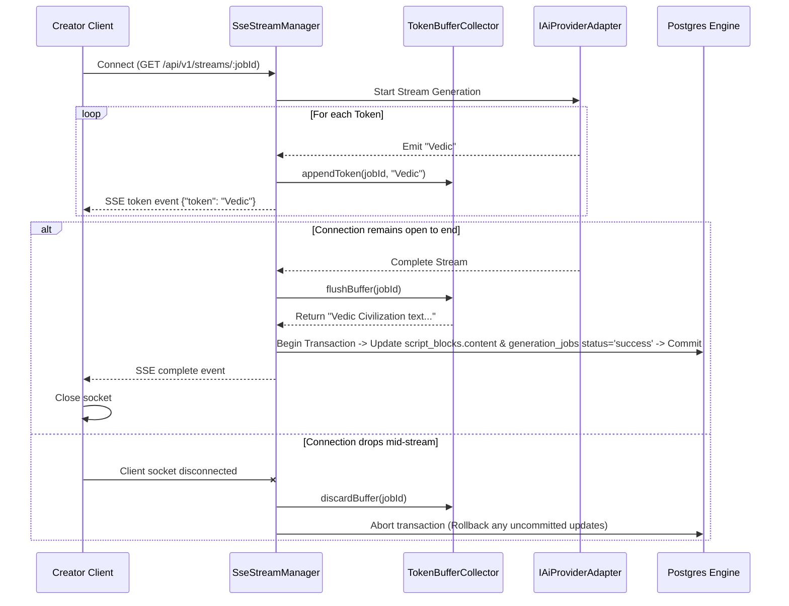

# TDD-019: Streaming Module Technical Specification

## 1. Metadata & Status Block

| Metadata Field | Value |
| :--- | :--- |
| **Document ID** | TDD-019 |
| **Module Name** | StreamingModule |
| **Version** | v1.0.0 |
| **Status** | IMPLEMENTATION READY |
| **Lifecycle** | Reference |
| **Implementation Status** | Partially Implemented |
| **Owner** | Unassigned |
| **Current Authority** | Level 9 — Technical design reference |
| **Last Verified** | 2026-07-31 |
| **EEP Phase Position** | Phase 8: API Interfaces & Client Shell (Module 8.2) |
| **Exact Prerequisites** | [TDD-003](TDD-003_Transaction_Module.md) (TransactionModule), [TDD-018](TDD-018_API_Controller_Module.md) (ApiControllerModule) |

---

## 2. Technical Architecture Overview

The `StreamingModule` coordinates real-time text token delivery to client interfaces using Fastify Server-Sent Events (SSE). It incorporates an in-memory stream buffer collector to collect tokens in real-time, executing the transactional commit boundary to ensure script blocks only persist once the stream successfully completes.

### File Placement Layout
```text
src/
└── server/
    └── shared/
        └── streaming/
            ├── streaming.module.ts     # NestJS module declaration
            ├── sse-stream.manager.ts   # SSE connection & event loop dispatcher
            ├── token-buffer.collector.ts # In-memory text fragment accumulator
            └── handlers/
                └── stream-lifecycle.handler.ts # Commit/rollback transactional gateway
```

### Framework Integration Strategy
- **Fastify SSE Adapting:** Bypasses standard Fastify JSON response hooks, writing stream chunks (`text/event-stream`) directly to raw socket buffers.
- **Transactional Commit Boundary:** If a client connection drops during stream playback, the collector halts writing to the database. The partial text is held in memory for recovery, and database transactions roll back to prevent half-written script states.

---

## 3. Interface & Contract Specification

### Token Buffer Collector Interface (`token-buffer.collector.ts`)
```typescript
export interface StreamBuffer {
  jobId: string;
  projectId: string;
  blockId: string;
  accumulatedText: string;
  lastTokenTimestamp: Date;
}

export interface ITokenBufferCollector {
  /**
   * Appends an incoming text token to the memory buffer array.
   */
  appendToken(jobId: string, token: string): void;

  /**
   * Retrieves and flushes the accumulated string buffer.
   */
  flushBuffer(jobId: string): string;

  /**
   * Cleans cached buffer contents on stream drop or completion.
   */
  discardBuffer(jobId: string): void;
}
```

### SSE Stream Manager Interface (`sse-stream.manager.ts`)
```typescript
import { Observable } from 'rxjs';

export interface SseEventMessage {
  data: {
    token: string;
    sequence: number;
    jobId: string;
  };
  type: 'token' | 'complete' | 'error';
}

export interface ISseStreamManager {
  /**
   * Initializes a persistent SSE event stream.
   */
  initializeStream(jobId: string): Observable<SseEventMessage>;

  /**
   * Safely terminates a stream and triggers transactional database commits.
   */
  closeStreamAndCommit(jobId: string): Promise<void>;

  /**
   * Aborts stream execution, rolling back database state to prevent corrupt writes.
   */
  abortStreamAndRollback(jobId: string, reason: string): Promise<void>;
}
```

---

## 4. Data & Schema Integration

- **Relational Tables Interacted:** `script_blocks` and `generation_jobs`.
- **Transaction Boundary Constraints:**
  During SSE token generation, SQL mutations targetting the script block's `content` are deferred:
  1. The LLM streams tokens, which compile in the in-memory `TokenBufferCollector`.
  2. If completion is reached successfully, the accumulated string is written to `script_blocks.content` inside a single TransactionManager block.
  3. The `generation_jobs.status` transitions to `success` atomically inside the same transaction block.

---

## 5. Detailed Lifecycle & Error Matrix

### Stream Buffer Transaction Commit Sequence



### Error Matrix

| Error Code / Name | Failure Type | Triggers / Condition | System Response / Recovery Action |
| :--- | :--- | :--- | :--- |
| Socket Disconnect | Transient | User loses network connection mid-stream. | Discards the memory accumulator, rollbacks pending transactions, and leaves the block in its pre-generation state. |
| Buffer Memory Leak | Transient | Streams crash without triggering abort/discard handlers. | A periodic garbage collector sweeps the buffer cache, purging items older than 5 minutes. |

---

## 6. Testing & Validation Criteria

### Unit Mocking Boundaries
- Stub `Observable` token emitters to test buffer accumulation.
- Test client socket drop simulations, asserting that transactional commits do not execute.

### Vitest Assertions
```typescript
import { describe, it, expect, vi, beforeEach } from 'vitest';
import { TokenBufferCollector } from './token-buffer.collector';

describe('TokenBufferCollector buffer management', () => {
  let collector: TokenBufferCollector;

  beforeEach(() => {
    collector = new TokenBufferCollector();
  });

  it('should accumulate tokens and return the full flushed text', () => {
    collector.appendToken('job-1', 'Vedic');
    collector.appendToken('job-1', ' Science');
    collector.appendToken('job-1', ' Script');

    const flushed = collector.flushBuffer('job-1');
    expect(flushed).toBe('Vedic Science Script');

    // Asserts buffer is cleaned post-flush
    const secondFlush = collector.flushBuffer('job-1');
    expect(secondFlush).toBe('');
  });
});
```
