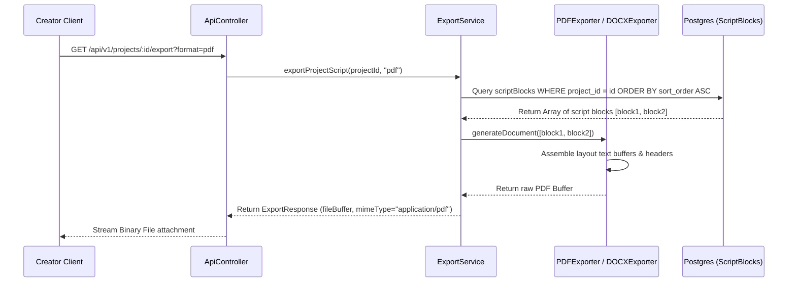

# TDD-020: Export Module Technical Specification

## 1. Metadata & Status Block

| Metadata Field | Value |
| :--- | :--- |
| **Document ID** | TDD-020 |
| **Module Name** | ExportModule |
| **Version** | v1.0.0 |
| **Status** | IMPLEMENTATION READY |
| **EEP Phase Position** | Phase 8: API Interfaces & Client Shell (Module 8.3) |
| **Exact Prerequisites** | [TDD-018](file:///c:/Users/Anmol/Desktop/rishi-ai/.docs/tdds/TDD-018_API_Controller_Module.md) (ApiControllerModule) |

---

## 2. Technical Architecture Overview

The `ExportModule` compiles the sequential script blocks associated with a project workspace into unified text files. It supports exports in three primary formats: Markdown, PDF, and DOCX. This provides a clean bridge to creators' external video creation, recording, or publishing workflows.

### File Placement Layout
```text
src/
└── server/
    └── shared/
        └── export/
            ├── export.module.ts        # NestJS module declaration
            ├── export.service.ts       # Main compile coordinator
            └── formatters/
                ├── markdown-export.ts  # Markdown builder compiler
                ├── pdf-export.ts       # PDF binary generator
                └── docx-export.ts      # DOCX binary generator
```

### Framework Integration Strategy
- **File Generation Pipelines:** Formatters write compiler streams into memory buffers, which are streamed back directly through Fastify reply pipes without saving temp files to the disk.
- **Dependency Isolation:** Relies on lightweight packages (`pdfkit`, `docx`) to assemble document nodes dynamically.

---

## 3. Interface & Contract Specification

### Export Service Interface (`export.service.ts`)
```typescript
export type ExportFormat = 'markdown' | 'pdf' | 'docx';

export interface ExportResponse {
  fileBuffer: Buffer;
  fileName: string;
  mimeType: string;
}

export interface IExportService {
  /**
   * Fetches, joins, and formats script blocks into the requested file buffer.
   */
  exportProjectScript(
    projectId: string,
    format: ExportFormat
  ): Promise<ExportResponse>;
}
```

### Format Exporter Contract (`markdown-export.ts` / `pdf-export.ts`)
```typescript
export interface CompiledBlockData {
  title: string;
  content: string;
  sortOrder: number;
}

export interface IFormatExporter {
  /**
   * Renders the array of script blocks into a binary file format.
   */
  generateDocument(blocks: CompiledBlockData[]): Promise<Buffer>;
}
```

---

## 4. Data & Schema Integration

- **Relational Tables Interacted:** Reads from `projects` and `script_blocks`.
- **Compile Order Verification:** Fetches script blocks chronologically sorted by the `sort_order` B-Tree index column to guarantee correct layout assembly.

---

## 5. Detailed Lifecycle & Error Matrix

### Document Export Processing Flow



### Error Matrix

| Error Code / Name | Failure Type | Triggers / Condition | System Response / Recovery Action |
| :--- | :--- | :--- | :--- |
| `ExportRenderException` | **FATAL** | External PDF/DOCX compiler libraries crash during stream drawing. | Aborts stream, logs trace with Pino, and returns HTTP 500 error envelope. |
| Empty Script | Transient | Creator requests an export on a project containing 0 script blocks. | Returns clean template PDF/markdown stating "No content generated". |

---

## 6. Testing & Validation Criteria

### Unit Mocking Boundaries
- Stub `script-blocks` database results to test compilation order formatting.
- Assert that returned PDF and DOCX streams are valid binary files.

### Vitest Assertions
```typescript
import { describe, it, expect, vi, beforeEach } from 'vitest';
import { ExportService } from './export.service';

describe('ExportService compilation order', () => {
  let exportService: ExportService;
  let mockBlocksRepo: any;
  let mockPdfExporter: any;

  beforeEach(() => {
    mockBlocksRepo = {
      getOrderedBlocks: vi.fn().mockResolvedValue([
        { title: 'Intro', content: 'Vedic intro text', sortOrder: 0 },
        { title: 'Conclusion', content: 'Vedic outro text', sortOrder: 1 },
      ]),
    };
    mockPdfExporter = {
      generateDocument: vi.fn().mockResolvedValue(Buffer.from('%PDF-1.4 mock content')),
    };
    exportService = new ExportService(mockBlocksRepo, mockPdfExporter);
  });

  it('should compile blocks sequentially and return file buffers', async () => {
    const result = await exportService.exportProjectScript('project-1', 'pdf');

    expect(result.mimeType).toBe('application/pdf');
    expect(result.fileBuffer.toString()).toContain('%PDF-1.4');
    expect(mockBlocksRepo.getOrderedBlocks).toHaveBeenCalledWith('project-1');
    expect(mockPdfExporter.generateDocument).toHaveBeenCalledWith(
      expect.arrayContaining([
        expect.objectContaining({ title: 'Intro' }),
        expect.objectContaining({ title: 'Conclusion' }),
      ])
    );
  });
});
```
